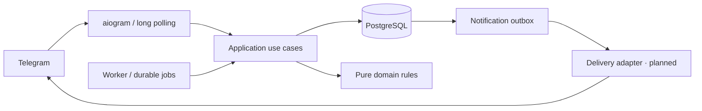

# Архитектура

Один Python-проект, два основных процесса: bot и worker.
PostgreSQL — источник истины. Redis, HTTP backend и frontend сейчас не требуются.

## Границы

- bot: форматирование, кнопки, маршрутизация, немедленный answerCallbackQuery.
- domain: часы, рейтинги, симуляция, таблицы, правила переходов; переданный seed и
  явные входные данные. Сетевых вызовов и импортов framework здесь нет.
- application: контракт аналитических эффектов и граница атомарного создания person;
  права на клуб и остальные игровые use cases остаются в плане.
- infrastructure: SQLAlchemy, репозитории, jobs/outbox.
- worker: получение просроченной работы и вызов application.
- portraits: стабильная identity/variant → цельный PNG и перекраска одежды;
  Telegram file_id cache остаётся отдельным адаптером в плане. SVG-пилот исторический.

## Долговечные операции

Уникальность тика: (match_id, tick_number). Сохранять в одной транзакции:
применённые команды, новое состояние, события, следующий срок и outbox.
Dedupe key очереди помогает, но не заменяет доменную защиту в БД.

Для claim клуба: блокировка свободного клуба и уникальный owner_telegram_id.
Для расширения: сериализованное выделение комплекта с повторной проверкой свободных
клубов лиги 5 после получения блокировки.
Для сезона: блокировка комплекта, уникальный переход для season_id, заранее рассчитанный
план для всех пяти лиг, обновление всех членств в одной транзакции.
Для денег: integer минимальные единицы, неизменяемый ledger и повторобезопасные операции.

## Jobs

Начальная таблица jobs содержит due_at, dedupe_key, kind, payload, status, attempts.
Диагностический handler system.ping показывает FOR UPDATE SKIP LOCKED и rollback.
Неизвестная задача помечается failed, чтобы очередь не зациклилась.
Обработчики игрового мира и ретраи ещё не реализованы.
Короткие DB-only handlers выполняются в транзакции с блокировкой строки.
Длительные/сетевые операции требуют lease и не должны удерживать DB lock.

## Уведомления

Outbox создаётся в той же транзакции, что и игровое событие.
Сетевой sender работает отдельно, учитывает retry_after и приоритеты.
Для повторных live-обновлений сохранять message_id и редактировать существующее табло.
Атомарную отправку сообщения в Telegram и commit PostgreSQL гарантировать нельзя:
доставка at-least-once может продублировать новое сообщение при аварии после отправки.
Документировать это ограничение, использовать стабильное табло и повторобезопасные edit.
Sender и политика доставки в плане, начальный worker сообщения не отправляет.

## Схема сейчас и далее

Аналитика запланирована до первого привлечения пользователей:
[контракт и метрики](analytics/measurement-plan.md), [события](analytics/event-catalog.md).
Application пишет успешное бизнес-событие атомарно с состоянием/accepted command;
infrastructure обеспечивает versioning, dedupe и псевдонимы до claim клуба.
Domain не импортирует аналитический сборщик. User-действия отделены от system/automation;
доставка уведомления не означает прочтение и не создаёт retention.
Отчёты используют PostgreSQL и операторский Grafana на HDC без публичного API.
Envelope/allowlist v1 реализован в `application.analytics`, [контракт](analytics/contract-v1.md).
Таблица псевдонимов присутствует в новой миграции; journey collection, сессии,
атрибуция, feedback и SQL-отчёты пока не реализованы.

Миграции foundation + game_foundation описывают 24 таблицы: topology/jobs/outbox,
managers/analytics IDs/ownership, persons/appearance registry/player/staff careers,
season memberships/standings, lineups, fixtures/matches/ticks и accepted commands.
[ERD, ограничения и транзакционные границы](data-model.md).
Схема не обеспечивает самостоятельно ровно 10 клубов в лиге: это инвариант seed/rollover.
Выполнение новой миграции на PostgreSQL пока не проверено: по текущему указанию
пользователя используются проверки без БД, и CI не создаёт тестовый PostgreSQL.
Далее отдельно: gameplay use cases, training, auctions, ledger, scouting, academy.
Схема не подменяет реализацию этих операций.

Источники:
[aiogram polling](https://docs.aiogram.dev/en/latest/dispatcher/long_polling.html),
[PostgreSQL locking](https://www.postgresql.org/docs/current/sql-select.html),
[SQLAlchemy asyncio](https://docs.sqlalchemy.org/en/20/orm/extensions/asyncio.html).

Владение и простая автоматика: [bot-clubs.md](bot-clubs.md). Дедлайн неактивности —
последнее игровое действие + шесть календарных месяцев, отдельно от матчевых jobs.
Освобождение/возврат и повторные напоминания защищаются транзакцией и dedupe.
