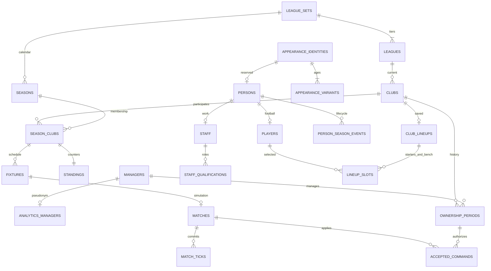

# Основание данных · AND-45

Модели находятся в `src/goaletto/infrastructure/models.py`, новая миграция —
`0002_game_foundation`. После применения схема содержит 24 таблицы: пять исходных
и 19 новых. Следующая миграция `0003_world_seed` добавляет `world_seed_receipts`
и held jobs; текущая схема содержит 25 таблиц. [Инициализация](world-initialization.md)
сохраняет первый мир/календарь, игровая симуляция ещё не реализована.

По указанию пользователя на текущем этапе не создаются тестовые БД и не выполняются
проверки с подключением к PostgreSQL, в том числе в CI. Проверены рендер SQL upgrade/
downgrade и соответствие замороженного DDL моделям. Выполнение DDL сервером,
`alembic check`, транзакции, блокировки и конкурентное назначение ещё не проверены.
Ни рабочая БД, ни HDC в этой работе не изменяются.

## Связи

## Менеджеры и владение

`managers` создаётся будущим игровым /start до выбора клуба. Telegram ID — BIGINT,
положительный и уникальный; UUID отделяет внутреннюю личность от Telegram.
`first_game_start_at` задаётся только первым принятым игровым стартом, не preview.
`is_internal` исключает операторов и собственные проверки из продуктовых отчётов.
`analytics_managers` хранит отдельный случайный UUID-псевдоним и ограниченный mapping.
Наличие таблицы не означает сбор событий или вычисление сессий.

`ownership_periods` хранит claim operation, менеджера, клуб, дату принятия,
`last_game_action_at`, `expires_at` и причину завершения. Частичные уникальные индексы
разрешают не более одного открытого периода на клуб и на менеджера.
CHECK срока рассчитывает ровно шесть месяцев в UTC с обрезкой дня месяца.
Чистая функция `domain.ownership.ownership_deadline` даёт тот же календарный результат.
Периодическая доставка, feedback и автоматика этот срок не продлевают.

Исходное `clubs.owner_telegram_id` оставлено как совместимая проекция, не второй
источник истории. Будущие claim/release должны обновлять период и проекцию вместе.
Миграция не сочиняет исторические даты для существующих владельцев; если в старой
БД они есть, перед игровым запуском требуется явное восстановление их периодов.
В новом мире владельцев ещё нет. Новые клубы по-прежнему выдаются только из tier 5.

## Человек, внешность и две карьеры

`persons` — единственный person ID, имя, игровой возраст, текущая карьера,
home calendar и сезон последнего начисленного года. Для свободного персонала
home calendar может быть NULL: его политика пока не утверждена. Нет второго
независимого счётчика staff age. Числовая граница хранения 0–150 не утверждает
возраст найма; новый футболист в application допускается только в 17–38.

`appearance_identities` хранит stable ID, исходный банк players/staff и версию каталога.
`appearance_variants` — подготовленные версии возраста/профессии и относительные пути
PNG/маски. Составной FK не позволяет назначить человеку вариант чужого лица.
Уникальный identity на person исключает повтор между людьми. Триггер запрещает
смену закреплённого лица, person ID/creation key и удаление человека с освобождением
его внешности. Каталог append-only: обновление или удаление опубликованных записей
запрещено; новый рисунок получает новый variant ID. Сама смена age/staff variant
в пределах прежней identity допустима. Отвергнутые модульные пилоты не публикуются.

`infrastructure.portrait_catalog.register_catalog` публикует существующий whole-v2
в транзакции, пакетами; повтор с теми же метаданными безопасен, конфликт ID — ошибка.
Дополнительные стадии не создают новые внешности для новых людей. На текущем этапе
1080 identity и 2820 variant, с частичным возрастным расширением.
Графику миграция не загружает: наличие иллюстраций не означает их игровую приёмку.

`application.persons.create_person` получает неизменяемый creation key/person ID и
разрешённые, предварительно проверенные варианты. Общий advisory transaction lock
`710045001` сериализует публикацию/назначение; повтор возвращает уже созданного
человека, не сбрасывая его нынешний возраст/карьеру. Недостаток подходящих свободных
лиц — `AppearanceExhausted`, без hash modulo и замены чужой внешностью.
Выбор устойчив по ID; разнообразие задаёт будущий seed выбором eligible IDs.
Функция не делает commit: профиль, лицо и seed должны сохраниться одной транзакцией.
Работа этой PostgreSQL-границы на сервере пока не проверена.

`players` — person PK, текущий клуб, позиции, навыки 1–20, форма 1–8,
опыт, числовая мораль и статус active/last_season/retired. Мораль 0–100 — шкала
хранения, а формулы изменения остаются задачей баланса AND-64. Альтернативных позиций
не более двух, без повторов и основной позиции. Игрок после пенсии сохраняет профиль
истории; текущий клуб NULL. `staff` использует тот же person PK, одну текущую занятость,
роль и пенсионные отметки. `staff_qualifications` — разные навыки/квалификации той же
личности, без клонов кандидата по фильтрам поиска. Допуск квалификации для текущей
работы, совместимость career/profile и активный возраст проверяет будущий use case
под person lock; схема не запускает кадровую механику. Клуб и роль одновременно NULL
означают кадровый пул; это не назначает всем бывшим футболистам новую профессию.

`person_season_events` уникальна по person/season/stage и append-only. Сохраняются
возраст, policy version, вероятность в базисных пунктах, draw 0–9999 и положительное/
отрицательное решение. Отдельные стадии: age_applied, player_last_decision,
player_retired, staff_last_decision, staff_retired, career_assigned, youth_replacement.
Для молодёжной замены `related_person_id` указывает созданного человека.
Квалификация, карьерный исход и пенсионная шкала персонала пока не реализованы.

## Сезоны, составы и матчи

`seasons` — независимый календарь комплекта, номер, persisted seed, границы и статус.
Уникальны set/number и единственный active season в комплекте. Статус rolled_over
требует сохранённого completion timestamp. Возраст/переходы выполняет будущий rollover.

`season_clubs` хранит принадлежность клуба лиге именно в этом сезоне и фиксированный
жребий 1–10. Составные FK удерживают сезон и лигу в одном league_set.
Текущая `clubs.league_id` после перехода не переписывает прошлые таблицы.
`standings` хранит только согласованные счётчики: сыграно = W+D+L,
очки = 3W+D, до 18 игр. Точные десять клубов и пять лиг обеспечит атомарный seed/
rollover; схема не утверждает, что произвольная частичная вставка уже целый мир.

`club_lineups` + `lineup_slots` сохраняют фиксированную схему, versioned tactics,
XI (слоты 1–11) и порядок скамейки (12–20). Игрок уникален в расстановке, составной
FK подтверждает его текущий клуб. Это ёмкость хранения стартовых 20, не новое правило
допуска 9 замен; матчевые лимиты остаются в AND-49/53. Наличие 11 допустимых здоровых
футболистов, GK и валидной схемы проверяет application перед блокировкой.

`fixtures` пока представляет двухкруговую лигу: туры 1–18, одна пара home/away за сезон,
разные клубы и составные ссылки на членство обоих в одной лиге этого сезона.
Плановое начало и lineup lock отделены от фактического старта/финиша; перенос
не искажает зрелость аналитики. Кубок и extra time добавятся в AND-65 отдельной миграцией.
Чистый календарь проверен: 18 туров, по одному матчу клуба в туре и обмен поля.

`matches` хранит persisted seed, engine/state versions, снимок стартовых игроков/
возрастов/внешностей/формы, состояние, счёт, completed tick, фазу и next_due_at.
Один fixture — один match. Регламентные completed ticks 0–30, final tick 30.
`match_ticks` — append-only PK(match, tick 1–30), игровые минуты = tick×3, deadline,
commit timestamp, события и state hash. Начало второго тайма в 18:00 — отдельный job,
а не фиктивный тик. Runtime, recovery и симуляция в этой работе не запускаются.

`accepted_commands` сохраняет Telegram update/effect, operation key, менеджера,
период владения, клуб, versioned payload, время принятия, target/applied tick и статус.
Уникальный update/effect и operation key предотвращают повтор команд; составной FK
связывает автора/клуб с конкретным периодом. Ссылка applied tick ведёт в тот же match.
Наличие FK не заменяет проверку, что период открыт и клуб участвует в матче.
JSON здесь — внутренняя versioned state/command граница, не свободная аналитика.

## Транзакционные границы для следующих задач

1. Единый порядок захвата: allocation lock при создании людей → league_set → club →
   ownership/person → match → command/денежные резервы. Общие операции должны
   придерживаться порядка; не захватывать allocation после person lock.
2. Seed: зарегистрированный запас проверенных лиц → 5 лиг/50 клубов/1000 people +
   profiles → фиксированные XI/bench → сезон и членства → один commit. Ошибка откатывает
   население и назначения, retry не создаёт дублей. Use case реализован в AND-46,
   исполнение на PostgreSQL пока не проверено.
3. Claim/release/action: club и ownership под lock, проверка actor/last action/deadline,
   период и owner projection, jobs/outbox, analytics effect одной транзакцией. Старый
   владелец не продлевает новый период. Геймплей AND-47/50 ещё не реализован.
4. Tick: match lock → прочитать сохранённый seed/state/accepted commands → чистый
   домен → вставить один tick → applied commands/state/следующий job/outbox/events →
   один commit. Network call никогда не находится в этой транзакции.
5. Rollover: один set lock, финальные standings, одновременные перемещения всех пяти
   лиг, person locks для retirement/age/decisions и отмены сделок последнего сезона,
   уникальные history stages и outbox. Межкомплектное старение ещё требует политики.

Границы развивают [архитектуру](architecture.md), [бот-клубы](bot-clubs.md),
[возраст футболистов](player-lifecycle.md), [персонал](staff-lifecycle.md) и
[контракт аналитики](analytics/contract-v1.md). Денежный ledger, аукционы, training,
скаутинг, сбор journey events, доставка и Telegram cache остаются отдельными задачами.

## Journey collection · миграция 0004

analytics_coverage, analytics_exclusions, journey_sessions и journey_events;
псевдоним/сессия FK, version/operation/effect unique, restricted export view.
Миграция не включает collection, preview не является launch cohort.
[Контракт хранения, sessions, deletion и доступы](analytics/storage.md).

## Regulation runtime · миграция 0005

Club capacity/supporters; Match paused_at/paused_seconds, immutable starting-input
trigger; match_stages и operation_attempts. Отдельный fixture/match abandoned;
MatchTick game_minute допускает остановку внутри тика. Command mentality и
regulation lifecycle allowlist. [Транзакционные границы](match-runtime.md).

Миграция0006: immutable match_results, composite Match/Fixture и исторические
membership FK. Receipt+Standing обновляются атомарно с финальным тиком.

Миграция0007: acquisition_campaigns, acquisition_first_touches, acquisition_touches;
opaque codes, immutable first attribution, pseudonym FK/CASCADE и retention indexes.
Миграция не начинает collection и не seed manager/campaign rows.
