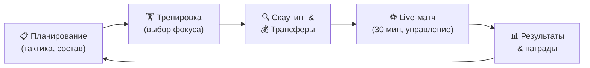
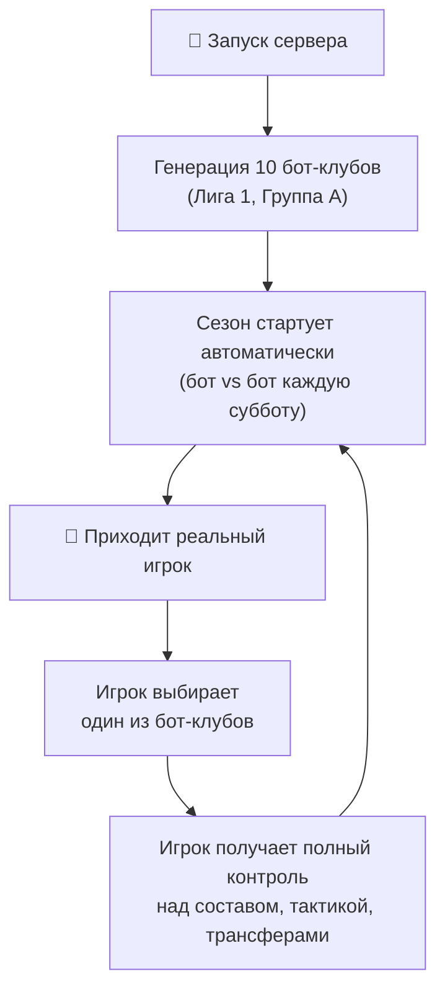
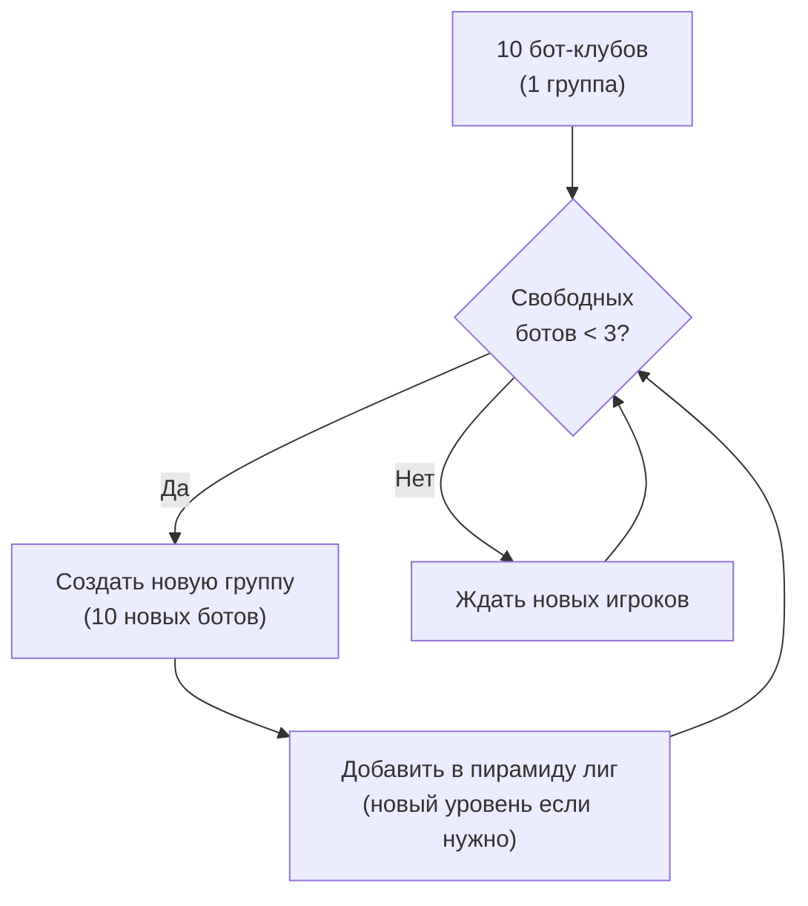
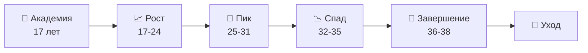
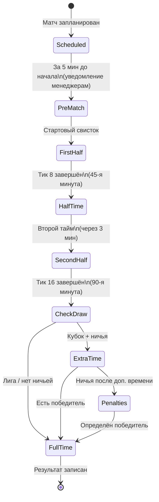
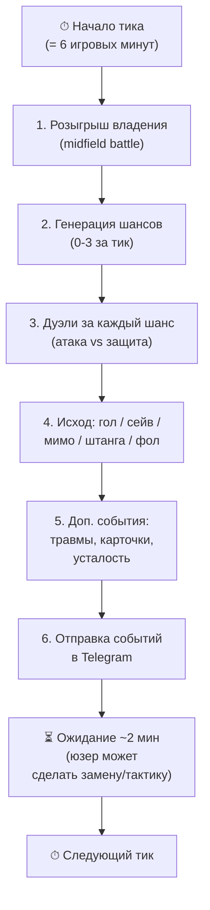
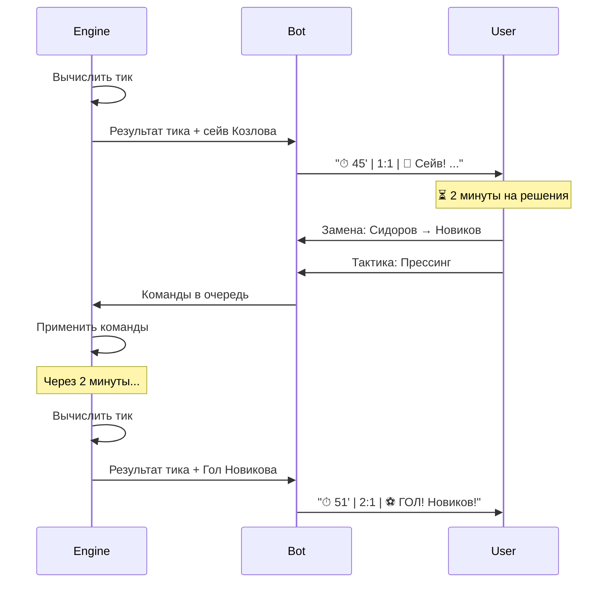
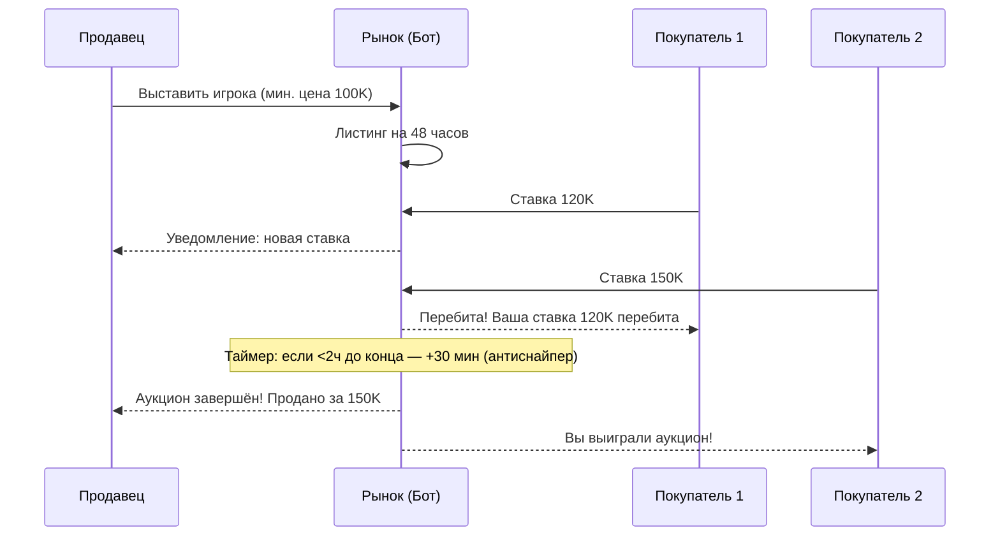
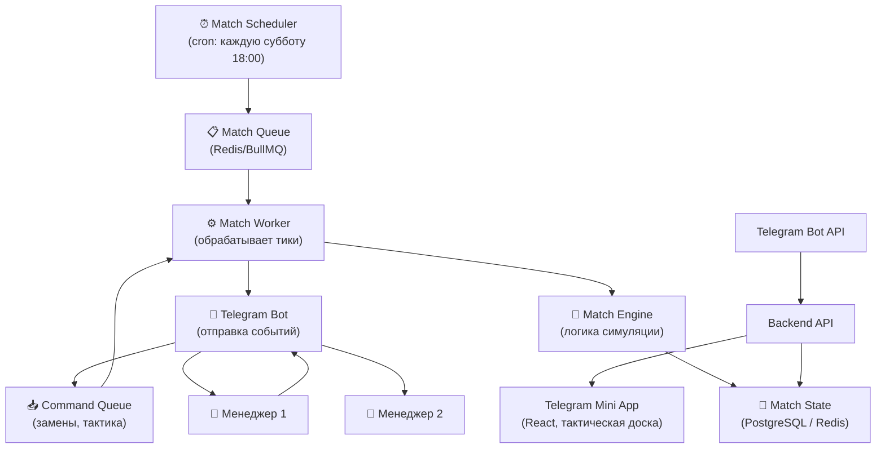

# ⚽ FootBot Manager — Game Design Document
## Телеграм-бот футбольного менеджера (полный прототип)

> **Версия:** 1.0
> **Дата:** 2026-10-10
> **Вдохновение:** Hattrick.org, Top Eleven, Football Manager

---

## 1. Концепция и философия

**FootBot Manager** — пошаговый (turn-based) футбольный менеджер, целиком живущий внутри Telegram-бота. Игрок управляет клубом: тренирует футболистов, покупает/продаёт на трансферном рынке, выращивает молодёжь через академию, выбирает тактику — и наблюдает результаты в **live-матчах**, длящихся 30 минут реального времени с возможностью делать замены и менять тактику прямо по ходу игры.

### Ключевые принципы
| Принцип | Описание |
|---------|----------|
| **Live-матчи** | Матч = 30 минут реального времени, игрок управляет командой по ходу |
| **Глубина, а не кликерство** | Минимум гринда, максимум стратегических решений |
| **Социальность** | Лиги из реальных игроков, чат, трансферы между людьми |
| **Telegram-native** | Inline-кнопки, callback-query, mini-app для сложных экранов |
| **Живой мир** | Лига работает с первого дня на бот-клубах, новый игрок входит в уже идущий сезон |

---

## 2. Игровой цикл (Core Loop)



### Временная модель
- **1 игровой сезон = 18 недель** реального времени (двухкруговой, 10 команд)
- **1 тур лиги = 1 неделя** (матчи по субботам в 18:00 UTC)
- Между матчами — окно для тренировок, трансферов, скаутинга
- **Кубковые матчи** — по средам (mid-week)
- **Межсезонье = 2 недели** (драфт молодёжи, трансферное окно)

---

## 3. Cold Start — Запуск лиги на ботах

### 3.1 Проблема

При запуске игры нет реальных игроков → нет лиги → нет матчей → нет интереса.
Нужна **«живая» лига с первого дня**, в которую можно войти и сразу видеть таблицу, матчи и результаты.

### 3.2 Стратегия: Seed League



### 3.3 Генерация бот-клубов при инициализации

При первом запуске сервер создаёт **стартовую лигу**:

| # | Название клуба | Архетип | OVR диапазон | Бюджет | Стадион |
|---|---------------|---------|--------------|--------|---------|
| 1 | ФК Стрела | 🏆 Топ-клуб | 12–16 | 800K | Ур. 3 |
| 2 | Динамо Сити | 🏆 Топ-клуб | 11–15 | 750K | Ур. 3 |
| 3 | Спартак Юнайтед | 💪 Крепкий | 10–14 | 600K | Ур. 2 |
| 4 | ФК Орион | 💪 Крепкий | 10–13 | 600K | Ур. 2 |
| 5 | Торпедо | 🔄 Середняк | 8–12 | 500K | Ур. 2 |
| 6 | Локомотив | 🔄 Середняк | 8–12 | 500K | Ур. 2 |
| 7 | Металлург | 🔄 Середняк | 7–11 | 450K | Ур. 1 |
| 8 | ФК Аврора | 🌱 Молодёжный | 6–10 (молодые) | 400K | Ур. 1 |
| 9 | ФК Заря | 📉 Аутсайдер | 5–9 | 350K | Ур. 1 |
| 10 | Атлетик | 📉 Аутсайдер | 5–9 | 350K | Ур. 1 |

#### Архетипы генерации

| Архетип | Описание | Состав |
|---------|----------|--------|
| 🏆 **Топ-клуб** | Сильные игроки, глубокая скамейка | 20 игроков, 3–4 с навыками 14+ |
| 💪 **Крепкий** | Ровный состав без провалов | 19 игроков, стабильные 10–13 |
| 🔄 **Середняк** | Средний, с 1–2 яркими игроками | 18 игроков, пара звёзд + средняя масса |
| 🌱 **Молодёжный** | Много молодых (17–21), слабые сейчас, но с потенциалом | 18 игроков, молодёжь с высоким потолком |
| 📉 **Аутсайдер** | Слабый состав, маленький бюджет | 18 игроков, невысокие навыки |

> [!TIP]
> Разные архетипы дают **выбор** новому игроку: хочешь сильный клуб и борьбу за титул? Или молодёжный проект с перспективой? Это создаёт **реиграбельность** и осмысленный старт.

### 3.4 Захват бот-клуба реальным игроком

#### Флоу регистрации

```
👤 /start

🏟 Добро пожаловать в FootBot Manager!
Выберите клуб, которым хотите управлять:

Лига 1 — Группа A (Тур 5 из 18):

1. 🏆 ФК Стрела — 1-е место (12 очков)
   ⭐ Сила: ██████████░░ (83)
   💰 Бюджет: 720K
   [🔍 Просмотр состава]

2. 🔄 Торпедо — 5-е место (7 очков)
   ⭐ Сила: ██████░░░░░░ (55)
   💰 Бюджет: 480K
   [🔍 Просмотр состава]

3. 🌱 ФК Аврора — 8-е место (4 очка)
   ⭐ Сила: █████░░░░░░░ (42)
   💰 Бюджет: 380K | 👶 Много молодёжи
   [🔍 Просмотр состава]

...
[📋 Показать все клубы]
```

#### Правила захвата

| Правило | Описание |
|---------|----------|
| Выбор только из ботов | Клубы, управляемые реальными игроками, недоступны |
| Состав «как есть» | Игрок получает текущий состав, финансы, позицию в таблице |
| Мгновенный контроль | С момента захвата все решения — за игроком |
| Нет отмены | Выбрал клуб → он твой минимум до конца сезона |
| Переименование | Можно сменить название клуба (1 раз бесплатно) |
| Бейдж | Первый сезон — «🤖→👤 Новый менеджер» |

#### Что видит игрок после захвата

```
🎉 Поздравляем! Вы — новый менеджер ФК Аврора!

📊 Текущая ситуация:
• Позиция: 8-е место (4 очка из 15)
• Следующий матч: Суббота vs ФК Орион
• Состав: 18 игроков (⚠️ нет запасного вратаря!)
• Бюджет: 380K

⚡ Что сделать первым делом:
[👥 Посмотреть состав]
[📋 Выставить состав на матч]
[🏋️ Выбрать тренировку]
```

### 3.5 AI-менеджер бот-клубов

Бот-клубы **не стоят на месте** — у них есть AI-менеджер, который принимает решения:

#### Уровни AI

| Уровень AI | Для какого архетипа | Описание |
|------------|---------------------|----------|
| **Простой** | Аутсайдер | Ставит лучших по OVR, случайная тактика |
| **Средний** | Середняк, Молодёжный | Учитывает позиции, форму, базовую тактику |
| **Умный** | Топ-клуб, Крепкий | Подбирает тактику под соперника, ротирует состав |

#### Поведение AI-менеджера по областям

**Состав на матч:**
```python
def ai_select_lineup(team, opponent, ai_level):
    if ai_level == "simple":
        # Просто отсортировать по OVR на своих позициях
        return sort_by_ovr(team.players)

    if ai_level == "medium":
        # Учитывать форму + основную позицию
        candidates = filter(lambda p: p.form >= 4 and not p.injured, team.players)
        return optimize_positions(candidates)

    if ai_level == "smart":
        # Анализ соперника + тактика + ротация уставших
        tactic = choose_counter_tactic(opponent)
        lineup = optimize_for_tactic(candidates, tactic)
        return lineup, tactic
```

**Тренировки:**
- Простой AI: всегда «Общекомандная»
- Средний AI: чередует тренировки по слабым местам состава
- Умный AI: целенаправленно тренирует молодых игроков в нужных навыках

**Трансферы (только в трансферное окно):**
- Простой AI: не покупает / не продаёт
- Средний AI: продаёт игроков 33+ лет, покупает на слабые позиции
- Умный AI: ищет выгодные сделки, торгуется

**Замены во время матча:**
```python
def ai_substitutions(team, match_state, ai_level):
    if ai_level == "simple":
        # Менять только травмированных и удалённых
        for player in match_state.injured_or_red:
            sub = find_replacement(team.bench, player.position)
            if sub:
                make_sub(player, sub)

    if ai_level in ("medium", "smart"):
        # + менять уставших (<40% выносливости)
        for player in match_state.active_players:
            if player.current_stamina < 0.4:
                sub = find_best_bench(team.bench, player.position)
                if sub:
                    make_sub(player, sub)

        # Умный AI: менять тактику если проигрывает в последние 20 минут
        if ai_level == "smart" and match_state.minute > 70:
            if match_state.losing:
                change_tactic("pressing")
                change_mentality("ultra_attack")
```

> [!IMPORTANT]
> Когда реальный игрок захватывает бот-клуб — AI полностью отключается.
> Если игрок **бросает** клуб (неактивен >2 недели), AI снова включается.

### 3.6 Масштабирование при росте



| Игроков | Групп | Уровней лиги | Бот-клубов |
|---------|-------|---------------|------------|
| 1–7 | 1 | 1 | 10→3 |
| 8–17 | 2 | 2 | 20→12 |
| 18–37 | 4 | 3 | 40→22 |
| 38–77 | 8 | 4 | 80→42 |
| 78+ | 16+ | 5+ | Динамически |

---

## 4. Система лиг

### 4.1 Структура пирамиды

```
         🏆 Лига 1 (1 группа × 10 клубов)
        ─────────────────────────────
       🥈 Лига 2 (2 группы × 10 клубов)
      ───────────────────────────────────
     🥉 Лига 3 (4 группы × 10 клубов)
    ─────────────────────────────────────────
   📋 Лига 4 (8 групп × 10 клубов)
  ───────────────────────────────────────────────
 📋 Лига 5 (16 групп × 10 клубов)
─────────────────────────────────────────────────────
```

- **Максимальная ёмкость:** 310 клубов (масштабируется добавлением уровней)
- При росте игроков — добавляются новые уровни пирамиды снизу

### 4.2 Формат сезона

| Параметр | Значение |
|----------|----------|
| Клубов в группе | 10 |
| Матчей в сезоне | 18 (двухкруговой) |
| Длительность сезона | 18 туров = 18 недель |
| Промоушен | Топ-2 поднимаются |
| Вылет | Нижние 2 вылетают |
| Стыковые | 3-е место ↔ 8-е место через плей-офф (2 матча) |

### 4.3 Кубок

- **Параллельно с лигой** — кубковый турнир на вылет
- Участвуют все клубы, жеребьёвка без сеяния
- Матчи кубка — по средам (mid-week)
- Финал — отдельное событие с увеличенными наградами

---

## 5. Система игроков

### 5.1 Атрибуты игрока

Каждый игрок описывается набором числовых атрибутов (1–20 шкала):

#### Основные навыки
| Навык | Описание | Влияет на |
|-------|----------|-----------|
| **Вратарское мастерство** | Умение ловить/отбивать мячи | Только для GK |
| **Защита** | Позиционная игра в обороне, отборы | DC, DL, DR |
| **Плеймейкинг** | Создание моментов, пасы | MC, ML, MR, AMC |
| **Фланговая игра** | Кроссы, дриблинг по флангу | ML, MR, DL, DR |
| **Атака** | Завершение, удары по воротам | FC, AMC, AML, AMR |
| **Стандарты** | Штрафные, угловые, пенальти | Любая позиция |

#### Физические характеристики
| Характеристика | Описание |
|----------------|----------|
| **Выносливость** | Как долго держит темп (влияет на форму к концу матча) |
| **Скорость** | Влияет на контратаки и фланговую игру |

#### Мета-атрибуты
| Атрибут | Описание |
|---------|----------|
| **Возраст** | 17–38 лет. Пик: 25–31. После 33 — деградация |
| **Опыт** | Растёт с матчами. Влияет на стабильность |
| **Форма** | 1–8 шкала. Колеблется от матча к матчу |
| **Лидерство** | Влияет на мораль команды (важно для капитана) |
| **Лояльность** | Влияет на вероятность отказа от трансфера |

### 5.2 Позиции

```
          GK
    DL — DC — DC — DR
    ML — MC — MC — MR
       AML — AMR
           FC
```

Каждый игрок имеет **основную позицию** и до 2 **альтернативных позиций**.
Игра на неосновной позиции = штраф –15% к эффективности.
Игра на неизвестной позиции = штраф –40%.

### 5.3 Жизненный цикл игрока



| Фаза | Возраст | Рост навыков | Деградация |
|------|---------|-------------|------------|
| Рост | 17–24 | Высокий (+0.3–0.8 за тренировку) | Нет |
| Пик | 25–31 | Медленный (+0.1–0.3) | Нет |
| Ранний спад | 32–33 | Нет | –0.1 за неделю |
| Поздний спад | 34–38 | Нет | –0.2–0.4 за неделю |

### 5.4 Рейтинг игрока (OVR)

Итоговый рейтинг рассчитывается на основе **позиции игрока** и релевантных навыков:

```
OVR(позиция) = Σ (навык_i × вес_i_для_позиции) / Σ весов
```

**Пример весов для FC (форвард):**
- Атака: ×5
- Скорость: ×3
- Плеймейкинг: ×2
- Стандарты: ×1
- Остальное: ×0

---

## 6. Матчевый движок (Real-Time)

### 6.1 Принцип: «30-минутный Live-матч»

Вместо мгновенного результата — матч **проигрывается в реальном времени**.
Менеджер наблюдает за ходом матча в Telegram и может вмешиваться.

| Параметр | Значение |
|----------|----------|
| Длительность матча | **30 минут** реального времени |
| Игровое время | 90 минут (+ доп. время в кубке) |
| 1 тик = | **2 реальные минуты = 6 игровых минут** |
| Тиков в 1-м тайме | 8 (0'–45') |
| Перерыв | **3 минуты** реального времени |
| Тиков во 2-м тайме | 8 (45'–90') |
| Всего тиков | 16 основных + до 5 доп. время |

### 6.2 Полный тайм-лайн матча

| Реальное время | Игровое время | Тик | Что происходит |
|---------------|--------------|-----|----------------|
| –5:00 | — | — | 📢 Уведомление: «Матч через 5 минут! Проверьте состав» |
| –1:00 | — | — | 🔒 Состав заблокирован (нельзя менять стартовый состав) |
| 0:00 | 1'–6' | 1 | ⚽ Стартовый свисток |
| 2:00 | 7'–12' | 2 | |
| 4:00 | 13'–18' | 3 | |
| 6:00 | 19'–24' | 4 | |
| 8:00 | 25'–30' | 5 | |
| 10:00 | 31'–36' | 6 | |
| 12:00 | 37'–42' | 7 | |
| 14:00 | 43'–45'+' | 8 | Конец 1-го тайма (+ компенсированное время) |
| 14:00–17:00 | — | — | ☕ **ПЕРЕРЫВ** — 3 минуты на замены и тактику |
| 17:00 | 46'–51' | 9 | Начало 2-го тайма |
| 19:00 | 52'–57' | 10 | |
| 21:00 | 58'–63' | 11 | |
| 23:00 | 64'–69' | 12 | |
| 25:00 | 70'–75' | 13 | |
| 27:00 | 76'–81' | 14 | |
| 29:00 | 82'–87' | 15 | |
| 31:00 | 88'–90'+' | 16 | Финальный свисток (или доп. время) |
| 31:30 | — | — | 📊 Финальный отчёт |

> **Итого: ~32 минуты** от уведомления до финального свистка.
> Менеджер может «подключиться» в любой момент и начать управлять.
> Каждые 2 минуты — пауза для принятия решений.

### 6.3 State Machine матча



### 6.4 Что происходит в одном тике (2 минуты)



### 6.5 Рейтинги секторов

Для матча команда оценивается по **7 секторам**:

| Сектор | Формула (упрощённо) |
|--------|---------------------|
| **Полузащита (центр)** | Σ плеймейкинг полузащитников × тактический бонус |
| **Атака (центр)** | Σ атака нападающих + бонус от плеймейкинга |
| **Атака (левый фланг)** | Фланговая игра ML/AML + скорость |
| **Атака (правый фланг)** | Фланговая игра MR/AMR + скорость |
| **Защита (центр)** | Σ защита DC + опыт |
| **Защита (левый фланг)** | Защита DL + скорость |
| **Защита (правый фланг)** | Защита DR + скорость |

### 6.6 Формулы движка

#### Владение (каждый тик)

```
possession_home = midfield_home / (midfield_home + midfield_away)

где midfield = Σ(плеймейкинг × позиц_вес × форма/8 × выносливость_множитель)
```

`выносливость_множитель` — падает к концу матча:
| Тик | Игровая минута | Множитель (вынос. 20) | Множитель (вынос. 10) |
|-----|---------------|----------------------|----------------------|
| 1–4 | 0'–24' | 1.00 | 1.00 |
| 5–8 | 25'–45' | 0.97 | 0.92 |
| 9–12 | 46'–69' | 0.94 | 0.83 |
| 13–16 | 70'–90' | 0.90 | 0.72 |

#### Генерация шансов

```
expected_chances = base_rate × possession_ratio × tactic_modifier

base_rate = 1.5 за тик (в среднем ~24 шанса за матч)
```

Фактическое количество — случайная величина из распределения Пуассона с λ = `expected_chances`.

#### Разрешение шанса (дуэль)

```
attack_power = attack_sector_rating × (0.8 + random(0, 0.4))
defense_power = defense_sector_rating × (0.8 + random(0, 0.4))

if attack_power > defense_power:
    shot_quality = (attack_power - defense_power) / attack_power
    save_chance = goalkeeper_rating / 20 × (1 - shot_quality × 0.5)
    if random() > save_chance:
        → ⚽ ГОЛ
    else:
        → 🧤 СЕЙВ
else:
    → 🛡 ПЕРЕХВАТ / ОТБОР
```

#### Типы событий в тике

| Событие | Вероятность | Условие |
|---------|------------|---------|
| ⚽ Гол | ~5–8% за шанс | Атака > Защита + вратарь пропускает |
| 🧤 Сейв | ~15% за шанс | Атака > Защита, но вратарь спасает |
| 🛡 Перехват | ~40% за шанс | Защита ≥ Атака |
| 🚩 Мимо ворот | ~10% за шанс | Атака > Защита, но промах |
| 🟨 Жёлтая | ~3% за тик | Случайная + модификатор «Прессинг» |
| 🟥 Красная | ~0.3% за тик | 2-я жёлтая или грубый фол |
| 🤕 Травма | ~1% за тик | Случайная + высокая интенсивность |
| 📐 Угловой | ~8% за шанс | Сейв/отбор → доп. шанс со стандарта |

### 6.7 Тактики

Менеджер выбирает **одну тактику** перед матчем (можно менять по ходу):

| Тактика | Эффект |
|---------|--------|
| **Нормальная** | Без модификаторов |
| **Прессинг** | +10% к полузащите, –5% к защите, больше расход выносливости |
| **Контратаки** | –10% к полузащите, +15% к атаке при перехвате |
| **Фланговая игра** | +20% к атаке с флангов, –10% к центральной атаке |
| **Оборона** | +15% к защите, –15% к атаке |
| **Длинные мячи** | Полузащита не важна, атака напрямую vs защита |

### 6.8 Пример live-трансляции в Telegram

```
⏱ МАТЧ НАЧАЛСЯ!
ФК Аврора 🆚 Динамо Сити
━━━━━━━━━━━━━━━━━━━━━━

⏱ 6' | 0:0
   Владение: 42% — 58%
   💨 Динамо контролирует мяч...
   [🔄 Замены] [📋 Тактика] [💬 Менталитет]

⏱ 12' | 0:1
   ⚽ ГОЛ! Мюллер (Динамо) — удар из штрафной!
   Владение: 38% — 62%
   [🔄 Замены] [📋 Тактика] [💬 Менталитет]

⏱ 18' | 0:1
   🧤 Сейв! Ваш вратарь Козлов отбивает удар Шмидта
   🟨 Сидоров (Аврора) — предупреждение за фол

⏱ 24' | 0:1
   Без моментов, борьба в центре
   ⚠️ Сидоров уже с карточкой — осторожно!
   [🔄 Замены] [📋 Тактика] [💬 Менталитет]

⏱ 30' | 1:1
   ⚽ ГОЛ!!! Иванов (Аврора) — контратака, пас Петрова!
   💪 Ваша команда воодушевлена!
   [🔄 Замены] [📋 Тактика] [💬 Менталитет]
```

### 6.9 Перерыв

```
━━━ ☕ ПЕРЕРЫВ (1:1) ━━━

📊 Статистика 1-го тайма:
   Владение: 40% — 60%
   Удары: 4 (2) — 7 (3)
   Угловые: 2 — 4
   Фолы: 3 — 1

⚠️ Сидоров — жёлтая карточка
⚠️ Выносливость низкая: Козлов (GK) 62%, Петров (ML) 55%

У вас есть 3 минуты на замены и смену тактики!

[🔄 Сделать замены]
[📋 Сменить тактику]
[💬 Настроить менталитет]

⏳ Второй тайм начнётся через 2:48...
```

---

## 7. Live-управление матчем

### 7.1 Доступные действия во время матча

| Действие | Когда доступно | Лимит |
|----------|---------------|-------|
| 🔄 **Замена** | Между тиками (2 мин окно) | 5 замен (3 окна + перерыв) |
| 📋 **Смена тактики** | Между тиками | 3 раза за матч |
| 💬 **Менталитет** | Между тиками | Без лимита |
| 🎯 **Инструкция игроку** | Между тиками | 3 раза за матч |

> [!IMPORTANT]
> **Действия применяются со следующего тика.** Если юзер даёт команду между тиками #8 и #9, она вступит в силу с тика #9. У юзера есть **2 полные минуты** на каждое решение.

### 7.2 Замены

```
🔄 Замены (осталось: 4/5, окон: 3/3)

Кого снять?
[Сидоров MC ⚡52% 🟨] ← рекомендация: устал + карточка
[Петров ML ⚡61%]
[Козлов GK ⚡70%]
[Иванов FC ⚡75%]
...все игроки с текущей выносливостью

━━━━━━━━━━━━━━━━━━

> Выбрано: Снять Сидорова (MC)

Кого выпустить?
[Новиков MC ⭐OVR 9 | Форма: 6]
[Фёдоров MC/AMC ⭐OVR 7 | Форма: 7]
[Громов DM ⭐OVR 8 | Форма: 5] ← не основная позиция!

> Выбрано: Выпустить Новикова

✅ Замена выполнена!
🔄 72' Сидоров ↔ Новиков
Осталось замен: 3/5 (окон: 2/3)
```

#### Окна замен

Замены выполняются в **3 окна** (как в реальном футболе):
- Каждое окно позволяет заменить 1+ игрока одновременно
- Если заменил одного в 50-й минуте, это 1 окно; другого в 70-й — 2-е окно
- Перерыв не расходует окно

### 7.3 Смена тактики

```
📋 Текущая тактика: Нормальная
Счёт: 0:1 (проигрываем)

Выберите новую тактику:
[⚡ Прессинг] — давим, рискуем сзади
[🏃 Контратаки] — ждём ошибку
[↗️ Фланговая] — навесы и кроссы
[🛡 Оборона] — удержать счёт
[⬆️ Длинные мячи] — обход полузащиты

> Выбрано: ⚡ Прессинг

✅ Тактика изменена!
📋 65' Ваша команда перешла на прессинг
(осталось смен тактики: 2/3)
```

### 7.4 Менталитет

Не путать с тактикой. Менталитет — **общий настрой** команды:

| Менталитет | Эффект |
|------------|--------|
| 🔥 Ультраатака | Атака +25%, Защита –20%. Голкипер выше |
| ⚔️ Атака | Атака +10%, Защита –5% |
| ⚖️ Баланс | Без модификаторов |
| 🛡 Защита | Защита +10%, Атака –5% |
| 🧱 Ультразащита | Защита +20%, Атака –20%. «Автобус» |

Менталитет можно менять **каждый тик** без ограничений — это основной стратегический рычаг:
- Проигрываешь 0:2 → ставишь ультраатаку
- Ведёшь 1:0 на последних минутах → ультразащита

### 7.5 Инструкция конкретному игроку

```
🎯 Индивидуальная инструкция

Выберите игрока:
[Иванов FC] [Петров ML] [Козлов MC] ...

> Выбрано: Иванов (FC)

Что должен делать?
[🎯 Бить издалека] — +шансы на дальние удары, –точность
[↙️ Смещаться влево] — помогает левому флангу
[↗️ Смещаться вправо] — помогает правому флангу
[⬇️ Оттягиваться назад] — помогает в обороне, –атака
[🏃 Рывки за спину] — контратакующие забеги

✅ Инструкция отдана!
🎯 70' Иванов начинает смещаться влево
```

### 7.6 Временнóе окно для действий



### 7.7 Что если менеджер не онлайн?

| Ситуация | Поведение |
|----------|-----------|
| Менеджер выставил состав, но не онлайн | Матч проходит без вмешательства, состав как выставлен |
| Менеджер не выставил состав | Автосостав: лучшие по OVR на своих позициях, тактика «Нормальная» |
| Бот-клуб | AI-менеджер делает замены по логике (§3.5) |

---

## 8. Система тренировок

### 8.1 Принцип

Каждую неделю менеджер выбирает **фокус тренировки** для всей команды.
Тренируются только те, кто играет на соответствующей позиции.

### 8.2 Типы тренировок

| Тип | Тренируемый навык | Кто получает эффект |
|-----|-------------------|---------------------|
| Вратарская | Вратарское мастерство | GK |
| Оборонительная | Защита | DC, DL, DR |
| Плеймейкинг | Плеймейкинг | MC |
| Фланговая | Фланговая игра | ML, MR, DL, DR |
| Атакующая | Атака | FC, AMC, AML, AMR |
| Стандарты | Стандарты | Назначенный исполнитель |
| Физическая | Выносливость + Скорость | Все |
| Общекомандная | Опыт (мини-бонус ко всему) | Все |

### 8.3 Расчёт прогресса

```
прирост = базовый_прирост × (1 + тренер_бонус) × возрастной_множитель × интенсивность
```

| Фактор | Значение |
|--------|----------|
| `базовый_прирост` | 0.4 за неделю |
| `тренер_бонус` | 0–50% (зависит от уровня тренера) |
| `возрастной_множитель` | 17 лет: ×1.5 / 22 года: ×1.2 / 27 лет: ×0.8 / 32+: ×0.3 |
| `интенсивность` | Выбирается менеджером: низкая (×0.6) / средняя (×1.0) / высокая (×1.3, +риск травмы) |

### 8.4 Тренерский штаб

| Роль | Эффект | Стоимость/неделя |
|------|--------|-----------------|
| Главный тренер | +20% эффективность тренировок | 50K |
| Тренер вратарей | +30% к вратарским тренировкам | 20K |
| Тренер защиты | +30% к оборонительным | 20K |
| Тренер атаки | +30% к атакующим | 20K |
| Физиотерапевт | –30% шанс травмы при высокой интенсивности | 30K |
| Фитнес-тренер | +30% к физическим тренировкам | 20K |

---

## 9. Система скаутинга

### 9.1 Общий принцип

Скаутинг — способ **обнаруживать** игроков для покупки, о которых ты иначе не знал бы.

### 9.2 Скауты

| Уровень скаута | Стоимость найма | Точность оценки | Радиус поиска |
|----------------|----------------|-----------------|---------------|
| Начинающий | 10K/нед | ±3 к реальным статам | Только своя лига |
| Опытный | 30K/нед | ±2 | Своя лига ±1 уровень |
| Элитный | 60K/нед | ±1 | Все лиги |

### 9.3 Механика

1. Менеджер задаёт **запрос**: позиция + мин. возраст + макс. возраст + приоритетный навык
2. Скаут ищет **1 неделю**
3. Возвращает **3–5 кандидатов** с приблизительными характеристиками (с погрешностью)
4. Менеджер может инициировать трансфер или **дополнительную разведку** (ещё 1 неделя → уменьшение погрешности)

### 9.4 Пример взаимодействия

```
🔍 Скаут вернулся с отчётом!

Найдено 3 игрока по запросу "FC, 18-24, Атака":

1. 🇧🇷 Родриго Силва, 20 лет, FC
   Атака: ~13 | Скорость: ~11 | Выносливость: ~9
   Клуб: ФК Буревестник | Цена: ~350K
   [📋 Подробнее] [💰 Сделать предложение] [🔍 Доразведка]

2. 🇩🇪 Маркус Вебер, 22 года, FC/AMC
   Атака: ~11 | Плеймейкинг: ~10 | Скорость: ~12
   Клуб: Свободный агент | Зарплата: ~8K/нед
   [📋 Подробнее] [✍️ Предложить контракт]

3. ...
```

---

## 10. Трансферная система

### 10.1 Типы трансферов

| Тип | Описание |
|-----|----------|
| **Трансферный рынок** | Менеджер выставляет игрока → аукцион 48 часов |
| **Прямое предложение** | Предложение конкретному клубу за его игрока |
| **Свободные агенты** | Игроки без контракта — подписание напрямую |
| **Обмен** | Игрок + деньги ↔ Игрок (обе стороны подтверждают) |

### 10.2 Аукционная механика



### 10.3 Оценка стоимости игрока

```
стоимость = базовая_цена × (OVR / 10)² × возрастной_коэффициент × форма_множитель
```

| Возраст | Коэффициент |
|---------|-------------|
| 17–20 | ×1.5 (потенциал) |
| 21–26 | ×1.3 |
| 27–30 | ×1.0 |
| 31–33 | ×0.6 |
| 34+ | ×0.3 |

### 10.4 Ограничения

- **Минимум 16 игроков** в составе (нельзя продать, если останется меньше)
- **Максимум 25 игроков**
- **Трансферное окно**: основное — межсезонье (2 недели); малое — на 9-й неделе сезона (1 неделя)
- **Потолок зарплат**: суммарная зарплата ≤ 70% дохода клуба (иначе минус мораль)

---

## 11. Молодёжная академия

### 11.1 Принцип

Академия — основной источник **бесплатных** молодых игроков. Инвестиции в академию = долгосрочная стратегия.

### 11.2 Уровни академии

| Уровень | Стоимость улучшения | Содержание/нед | Выпускников/сезон | Средний потенциал |
|---------|--------------------|-----------------|--------------------|-------------------|
| 1 (Базовая) | — | 10K | 1 | Навыки 3–7 |
| 2 | 200K | 20K | 1–2 | Навыки 4–9 |
| 3 | 500K | 35K | 2 | Навыки 5–11 |
| 4 | 1M | 55K | 2–3 | Навыки 6–13 |
| 5 (Элитная) | 2.5M | 80K | 3 | Навыки 7–15 |

### 11.3 Выпуск молодёжи

- В **межсезонье** академия выпускает юных игроков (17 лет)
- Менеджер видит **3–5 кандидатов** из академии
- Можно подписать **до лимита** выпускников (зависит от уровня)
- Не подписанные — уходят в пул свободных агентов

### 11.4 Скрытый потенциал

Каждый молодой игрок имеет **скрытый потолок** навыков (не видим напрямую):
- Потолок определяется при генерации (зависит от уровня академии)
- Тренировки приближают навык к потолку, но не превышают его
- Подсказки потолка: тренер может сказать «у этого парня огромный потенциал в атаке» (качественно)

```
🎓 Выпуск академии!

Ваша академия (Ур. 3) подготовила 2 воспитанников:

1. 🇫🇷 Жан-Пьер Дюпон, 17 лет, MC
   Плеймейкинг: 7 | Выносливость: 6 | Скорость: 8
   💡 Тренер: "Очень талантливый плеймейкер, может вырасти в звезду"
   [✅ Подписать] [❌ Отпустить]

2. 🇪🇸 Карлос Руис, 17 лет, DR
   Защита: 6 | Скорость: 9 | Фланговая: 5
   💡 Тренер: "Неплохой защитник, но потолок средний"
   [✅ Подписать] [❌ Отпустить]
```

---

## 12. Экономика клуба

### 12.1 Источники дохода

| Источник | Описание | Размер |
|----------|----------|--------|
| **Матчевый доход** | Билеты от домашних матчей | Зависит от стадиона и лиги |
| **Спонсор** | Еженедельная выплата | Зависит от лиги и позиции |
| **Призовые** | За позицию в лиге/кубке | Фиксированные суммы |
| **Продажа игроков** | Трансферы | Переменная |
| **Мерч** | Пассивный доход | Зависит от фанбазы |

### 12.2 Расходы

| Расход | Описание |
|--------|----------|
| **Зарплаты игроков** | Суммарная зарплата состава |
| **Штаб** | Тренеры, скауты |
| **Стадион** | Содержание и расширение |
| **Академия** | Содержание |
| **Трансферы** | Покупка игроков |

### 12.3 Стадион

| Уровень | Вместимость | Стоимость расширения | Доход/матч |
|---------|-------------|---------------------|------------|
| 1 | 5,000 | — | 25K |
| 2 | 10,000 | 300K | 50K |
| 3 | 20,000 | 800K | 100K |
| 4 | 35,000 | 2M | 175K |
| 5 | 50,000 | 5M | 250K |

> [!NOTE]
> Заполняемость зависит от **лиги**, **позиции в таблице** и **серии результатов**.
> В нижних лигах стадион на 50K никогда не заполнится — вложения нужно делать с умом.

### 12.4 Начальный бюджет (для бот-клубов)

Зависит от архетипа (см. §3.3). При захвате игрок получает текущее финансовое состояние клуба.

---

## 13. Мораль и химия

### 13.1 Мораль команды

**Шкала 1–10.** Влияет на производительность всей команды (±10% к рейтингам секторов).

| Фактор | Эффект на мораль |
|--------|-----------------|
| Победа | +0.5 |
| Ничья (фаворит) | –0.3 |
| Ничья (аутсайдер) | +0.2 |
| Поражение | –0.5 to –1.0 |
| Серия побед (3+) | Бонус +0.3 |
| Зарплата > 70% дохода | –0.5/неделю |
| Продажа фаворита | –1.0 |
| Покупка звезды | +0.5 |

### 13.2 Индивидуальная форма

- Случайные колебания 1–8 каждую неделю
- Базируется на предыдущем значении ±1–2
- Высокая мораль команды → выше средняя форма

---

## 14. Интерфейс Telegram-бота

### 14.1 Главное меню

```
🏠 Главное меню — ФК «Моя Команда»

📊 Лига: 3-й дивизион, группа A | 4-е место
💰 Бюджет: 1,240K | 📅 Тур 12 из 18

[👥 Состав]      [⚽ Матч]
[🏋️ Тренировка]  [💰 Трансферы]
[🔍 Скаутинг]    [🎓 Академия]
[🏟 Стадион]     [📊 Таблица]
[🏆 Кубок]       [📈 Финансы]
[⚙️ Настройки]   [❓ Помощь]
```

### 14.2 Навигация

- Все основные действия — через **inline-кнопки**
- Сложные экраны (расстановка состава, тактическая доска) — через **Telegram Mini App**
- Уведомления — **push** через бота:
  - Матч через 5 минут!
  - Результат матча
  - Скаут вернулся с отчётом
  - Ваша ставка на аукционе перебита
  - Выпускник академии готов
  - Трансферное окно открывается

### 14.3 Команды бота

| Команда | Описание |
|---------|----------|
| `/start` | Регистрация / главное меню |
| `/squad` | Просмотр состава |
| `/lineup` | Установка состава на матч |
| `/train` | Выбор тренировки |
| `/scout` | Управление скаутингом |
| `/market` | Трансферный рынок |
| `/table` | Турнирная таблица |
| `/match` | Инфо о следующем/последнем матче |
| `/finance` | Финансовый отчёт |
| `/help` | Справка |

### 14.4 Уведомления

```
📢 Уведомление!

⚽ Результат матча (Тур 12):
ФК Моя Команда 2 — 1 ФК Динамо

⭐ Лучший игрок: Иванов (рейтинг 8.2)
📊 Вы поднялись на 3-е место!

[📋 Подробный отчёт] [📊 Таблица]
```

---

## 15. Защита от злоупотреблений

| Угроза | Контрмера |
|--------|-----------|
| **Мульти-аккаунты** | Привязка к Telegram ID; ограничение 1 клуб/аккаунт |
| **Договорные трансферы** | Минимальная цена = 70% рыночной стоимости; алгоритм детекции подозрительных сделок |
| **Заброшенные клубы** | Если менеджер неактивен >2 недели — бот берёт управление (автосостав, автотренировка); >4 недели — клуб становится ботом |
| **Спам** | Rate limiting на все действия |

---

## 16. Технический стек

### 16.1 Архитектура



### 16.2 Match State (хранимый в Redis во время матча)

```json
{
  "match_id": "m_20261010_001",
  "status": "second_half",
  "current_tick": 11,
  "game_minute": 66,
  "score": [2, 1],
  "home": {
    "club_id": "c_aurora",
    "manager_type": "human",
    "manager_id": "tg_12345678",
    "lineup": ["p_101", "p_102", "..."],
    "bench": ["p_115", "p_116", "..."],
    "tactic": "pressing",
    "mentality": "attack",
    "subs_made": 2,
    "sub_windows_used": 1,
    "tactic_changes": 1,
    "player_states": {
      "p_101": {"stamina": 0.72, "yellow": false, "injured": false},
      "p_102": {"stamina": 0.55, "yellow": true, "injured": false}
    }
  },
  "away": { "..." : "..." },
  "events": [
    {"tick": 3, "minute": 18, "type": "goal", "team": "away", "player": "p_205"},
    {"tick": 5, "minute": 30, "type": "goal", "team": "home", "player": "p_108"},
    {"tick": 9, "minute": 54, "type": "goal", "team": "home", "player": "p_108"}
  ],
  "pending_commands": []
}
```

### 16.3 Обработка тика (псевдокод)

```python
async def process_tick(match: MatchState):
    # 1. Применить pending команды (замены, тактика)
    for cmd in match.pending_commands:
        apply_command(match, cmd)
    match.pending_commands.clear()

    # 2. Рассчитать текущие рейтинги секторов (с учётом усталости)
    home_ratings = calculate_sector_ratings(match.home)
    away_ratings = calculate_sector_ratings(match.away)

    # 3. Определить владение
    possession = calc_possession(home_ratings.midfield, away_ratings.midfield)

    # 4. Генерация шансов
    home_chances = generate_chances(possession, match.home.tactic)
    away_chances = generate_chances(1 - possession, match.away.tactic)

    # 5. Разрешить каждый шанс
    events = []
    for chance in home_chances + away_chances:
        event = resolve_chance(chance, home_ratings, away_ratings)
        events.append(event)

    # 6. Дополнительные события (карточки, травмы)
    events += generate_random_events(match)

    # 7. Обновить выносливость всех игроков
    update_stamina(match)

    # 8. Обновить состояние матча
    match.current_tick += 1
    match.game_minute += 6
    match.events.extend(events)

    # 9. Отправить события обоим менеджерам
    await broadcast_events(match, events)

    # 10. Запланировать следующий тик через 120 секунд
    if match.current_tick <= 16:
        if match.current_tick == 8:
            schedule_next_tick(match, delay=180)  # перерыв 3 мин
        else:
            schedule_next_tick(match, delay=120)  # обычный тик 2 мин
    elif is_cup_and_draw(match):
        start_extra_time(match)
    else:
        await finalize_match(match)
```

### 16.4 Стек технологий

| Компонент | Технология |
|-----------|------------|
| Бот-фреймворк | python-telegram-bot / Telegraf.js |
| Backend | FastAPI (Python) или NestJS (Node.js) |
| БД | PostgreSQL |
| Кэш/Очереди | Redis + Celery/BullMQ |
| Планировщик | APScheduler / node-cron |
| Mini App | React + Vite |
| Хостинг | VPS / Docker Compose |
| CI/CD | GitHub Actions |

---

## 17. Монетизация (опционально)

> [!IMPORTANT]
> Модель **не Pay-to-Win**. Только косметика и удобство.

| Предмет | Цена (⭐ = Telegram Stars) | Эффект |
|---------|---------------------------|--------|
| Кастомный герб клуба | 50⭐ | Косметика |
| Кастомная форма | 30⭐ | Косметика |
| Расширенная аналитика | 100⭐/сезон | Подробная статистика соперника |
| Доп. скаут-слот | 80⭐ | +1 параллельный скаутинг |
| VIP-уведомления | 50⭐/сезон | Расширенные push во время матча |

---

## 18. Roadmap развития

### Фаза 1 — MVP (8–10 недель)
- [ ] Cold Start: генерация 10 бот-клубов
- [ ] AI-менеджер (простой уровень)
- [ ] Захват бот-клуба реальным игроком
- [ ] Базовая лига (1 уровень, 1 группа)
- [ ] Real-time матчевый движок (30 мин, 16 тиков)
- [ ] Live-управление: замены + смена тактики
- [ ] Просмотр состава и таблицы
- [ ] Тренировки (базовые)

### Фаза 2 — Core Features (6–8 недель)
- [ ] Трансферный рынок (аукцион)
- [ ] Система скаутинга
- [ ] Академия (базовая)
- [ ] Кубковый турнир (доп. время, пенальти)
- [ ] Экономика и стадион
- [ ] AI-менеджер (средний и умный)
- [ ] Менталитет + инструкции игрокам
- [ ] Масштабирование: новые группы при росте

### Фаза 3 — Polish & Scale (6–8 недель)
- [ ] Telegram Mini App (тактическая доска, состав)
- [ ] Пирамида лиг (3–5 уровней), промоушен/вылет
- [ ] Расширенная статистика и история матчей
- [ ] Мораль и химия
- [ ] Обмены игроками
- [ ] Монетизация (Telegram Stars)

### Фаза 4 — Advanced (бэклог)
- [ ] Международные турниры (из лучших игроков разных клубов)
- [ ] Дружеские матчи
- [ ] Клубные альянсы / федерации
- [ ] Историческая статистика и зал славы
- [ ] Достижения и ачивки
- [ ] Турниры с призами

---

## 19. Ключевые метрики успеха

| Метрика | Цель (6 мес.) |
|---------|---------------|
| DAU (ежедневные) | 500+ |
| Retention D7 | >40% |
| Retention D30 | >20% |
| Среднее время сессии | 10–15 минут (матч = 30 мин) |
| % онлайн во время матча | >50% менеджеров |
| Количество сезонов на игрока | >2 |
| NPS | >50 |

---

> [!TIP]
> **Следующий шаг:** Утвердить этот документ → создать детальные user stories для Фазы 1 → начать разработку MVP.
