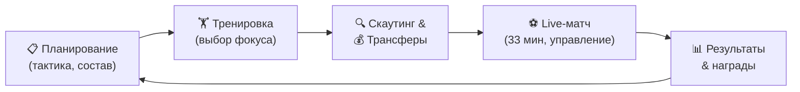
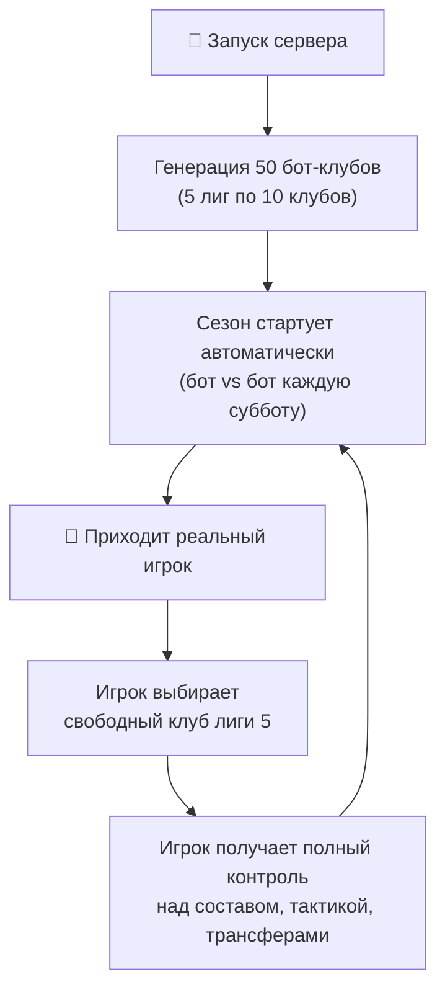
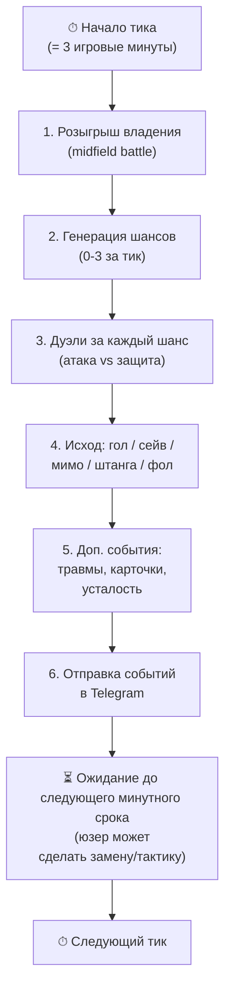
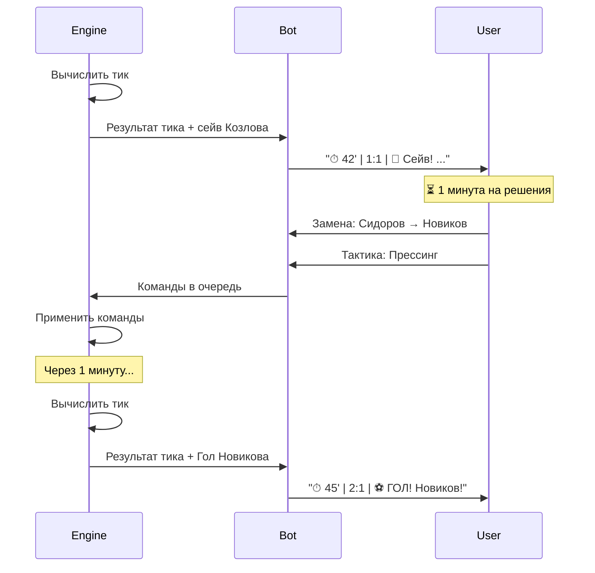
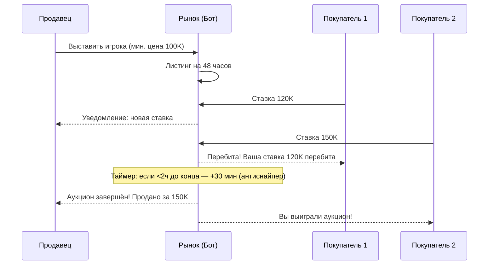

# ⚽ Goaletto — Game Design Document

Уточнение 2026-10-20: [задачи интерфейса и банкротства](docs/ui-feedback-2026-10-20.md)
имеют приоритет над прежними примерами. AND-143/144: полная таблица 10 клубов,
«Настройки» и выбор целого UTC offset с местным временем. В AND-145/146 ожидаются
флаги национальностей и переименование клуба после claim. Принято для AND-147:
отрицательный баланс до оценочной стоимости команды; превышение означает
банкротство/переход к боту. Финансовый runtime ещё использует cash/arrears;
новое правило не считать реализованным по этой записи.

Уточнение 2026-10-15: лига, кубки и товарищеские влияют на форму и развитие
по сыгранным минутам. Товарищеские дают меньший прогресс, чем официальные;
множитель ещё не выбран. Матчевая практика не должна сводиться к одной усталости.
Это целевое правило; текущий код развития пока подключён только к лиге.

Приняты [расчётные подпакеты переходов и кубка](docs/tournament-domain.md);
их подключение к PostgreSQL/rollover/match runtime ещё предстоит.

Уточнение 2026-10-15: день 3 — добровольное свободное окно для тренировки,
товарищеского матча или отдыха без штрафа. Автоматической товарищеской игры нет.

Реализованы AND-117/129: [сезонные спонсорские условия](docs/season-sponsorship.md)
и [выбор свободных UTC-дней тренировок на десять дней вперёд](docs/training.md).
Эти правила заменяют текущую позицию для дохода спонсора и недельные примеры ниже.

Реализованы AND-113/114: [матчевое развитие](docs/match-development.md)
и [карьера бывших игроков](docs/retired-staff-offers.md).
> AND-111/112 (2026-10-15): [дневные профильные тренировки и вклад штаба](docs/training.md)
> реализованы; матрица профессий и [сезонные пределы](docs/staff-training-calibration.md)
> заменяют старые недельные коэффициенты ниже. Матчевое начисление — AND-113.
> Последнее уточнение 2026-10-14: тренировка в любой свободный от матчей UTC-день,
> включая дни кубка/чемпионов без участия клуба; товарищеская игра исключает тренировку.
> Несколько тренировочных дней за цикл допустимы. [Задача AND-129](https://linear.app/andrei-brazhnikov/issue/AND-129/naznachat-trenirovki-v-lyuboj-svobodnyj-ot-matchej-den).
> Позднейшие вводные 2026-10-14: переходы между любыми совместимыми лигами
> соседнего уровня, без фиксированной лестницы комплектов; 18 циклов по 4 дня:
> кубок, чемпионские кубки, тренировки/товарищеские, лига.
> Зарплаты и скаут используют игровой цикл; тренировки — свободные дни; timezone/предпочтение
> старта, круговое среднее через полночь и 10-дневный горизонт назначений.
> [Подробная сетка кубков, расписание и восстановление](docs/calendar-cups-update-2026-10-14.md)
> заменяют старые субботние/средовые и семидневные примеры. Новая реализация впереди.
> Вводные 2026-10-14 имеют приоритет над таблицами ниже:
> свободные новые игроки 26–30 лет, разное качество и до 3 близких позиций;
> новые сотрудники 50–56 лет, качество определяет возможности/эффекты;
> слабый стартовый главный тренер, небольшой возрастной рост за тренировки/минуты;
> случайная вторая карьера с первым предложением родному клубу и зарплатой −20%;
> еженедельные приватные скаутские находки 17–21, сезонный контракт спонсора.
> [Полные вводные, предложения дизайна и задачи](docs/gameplay-update-2026-10-14.md).
> Новый бюджет/цены/коэффициенты должны быть рассчитаны; код прототипа ещё не заменён.
> Уточнения 2026-10-13: существующий банк лиц переиспользуется для новых людей;
> собственное лицо, person ID и история стабильны. Пулы общие на игру: 12 предложений
> футболистов (включая доступные аукционы), по 2 сотрудника каждой профессии. Генерация
> только при дефиците, покупка/найм восполняет максимум одно место. При нехватке
> персонала подходят бывшие футболисты с прежним человеком/лицом. Шкала последнего
> рабочего сезона 60–70 утверждена: 5/8/12/18/25/35/45/60/75/90/100%.
> Реализация: [общий rollover](docs/season-rollover.md), [пулы](docs/candidate-pools.md).

> Последнее уточнение скаута: [поиск по позиции на 4/8/12/16 дней](docs/scouting.md),
> один итоговый список в самом конце, длиннее поиск — больше кандидатов на выбор.
> Поиск и подписание оплачиваются отдельно; еженедельных промежуточных находок нет.


> AND-105/107 (2026-10-15): действуют [economy-cycle-v2](docs/economy-calculation.md)
> и [взрослый публичный рынок](docs/candidate-pools.md). Эти коэффициенты заменяют
> старые числовые примеры экономики ниже; старт 600K, зарплаты за четыре дня.
> Скаутские предложения различаются по качеству и цене; средняя находка с заданием
> около 400K. Поток скаута реализован в AND-116; сезонное продление спонсора — AND-117.


> AND-109/110 (2026-10-15): [стартовые главные тренеры и замена штаба](docs/coaches-and-staff.md)
> реализованы. Возможности фиксируются при подготовке матча; кадровые операции доступны в `/staff`.
> Главного тренера нельзя уволить без замены: найм другого тренера атомарно заменяет прежнего.

## Телеграм-бот футбольного менеджера (полный прототип)

> **Версия:** 2.7
> **Дата:** 2026-10-14
> **Вдохновение:** Hattrick.org, Top Eleven, Football Manager

---

> **Изменения пользователя, версия 2:** только Telegram-бот и Python; тик раз в минуту;
> 30 минут игры + 3 минуты перерыва; комплекты 5 лиг × 10 клубов; 2 клуба вверх/2 вниз;
> новые менеджеры входят только в лигу 5; при отсутствии мест создаётся новый полный комплект.
> Бот-клубы без нейросетей: фиксированный состав, без тренировок, замены только травмированных;
> пенсия пополняется из молодёжки в межсезонье; владение сохраняется шесть календарных месяцев
> после последнего игрового действия. Подробности: docs/bot-clubs.md.
> Возраст +1 за сезон; в 32–38 прогрессивная вероятность следующего последнего сезона,
> в 38 — 100%; метка заранее на полный сезон. docs/player-lifecycle.md.
> Шкала 5/10/20/35/55/80/100% утверждена; последний сезон запрещает сделки с игроком.
> Новые портреты пока мужские, отдельные банки игроков/персонала; одежда в цветах клуба.
> После проверки комбинаций выбраны цельные портреты, экспорт 256/96px. Бывшие игроки
> могут продолжить карьеру в персонале; рабочий возраст и пенсия: docs/staff-lifecycle.md.
> Выбран стиль C — Dugout. Архив версии 1: docs/reference/original-gdd-v1.md.
> Полные актуальные правила: docs/game-rules.md. Таблицы цен/баланса далее — первоначальные
> гипотезы GDD, которые нужно проверить; псевдокод не означает реализованную функцию.

## 1. Концепция и философия

**Goaletto** — пошаговый (turn-based) футбольный менеджер, целиком живущий внутри Telegram-бота. Игрок управляет клубом: тренирует футболистов, покупает/продаёт на трансферном рынке, выращивает молодёжь через академию, выбирает тактику — и наблюдает результаты в **live-матчах**, длящихся 33 минуты реального времени (30 минут игры + 3 минуты перерыва) с возможностью делать замены и менять тактику прямо по ходу игры.

### Ключевые принципы
| Принцип | Описание |
|---------|----------|
| **Live-матчи** | Матч = 30 минут игры + 3 минуты перерыва, игрок управляет командой по ходу |
| **Глубина, а не кликерство** | Минимум гринда, максимум стратегических решений |
| **Социальность** | Лиги из реальных игроков, чат, трансферы между людьми |
| **Telegram-native** | Только сообщения и inline-кнопки; без Mini App и JavaScript |
| **Живой мир** | Лига работает с первого дня на бот-клубах, новый игрок входит в уже идущий сезон |

---

## 2. Игровой цикл (Core Loop)



### Временная модель
- **1 игровой сезон = 18 недель** реального времени (двухкруговой, 10 команд)
- **1 тур лиги = 1 неделя** (матчи по субботам в 18:00 UTC)
- Между матчами — окно для тренировок, трансферов, скаутинга
- **Кубковые матчи** — по средам (mid-week)
- **Межсезонье = 2 недели** (драфт молодёжи, трансферное окно)

---

## 3. Cold Start — Запуск лиги на ботах

### 3.1 Проблема

При запуске игры нет реальных игроков → нет лиги → нет матчей → нет интереса.
Нужна **«живая» лига с первого дня**, в которую можно войти и сразу видеть таблицу, матчи и результаты.

### 3.2 Стратегия: Seed League



### 3.3 Генерация бот-клубов при инициализации

Все 50 клубов изначально без владельцев. Они играют друг с другом общей симуляцией.
Стартовый состав — 20 футболистов на клуб, всего 1 000 в первом комплекте.
Каждому человеку назначается уникальная внешность без повторов между людьми.
Недостаток каталога требует его пополнения, а не повторного назначения лица.
У всех новых клубов примерно одинаковые базовые составы независимо от уровня лиги:
единый позиционный шаблон и близкая сила, без сильных/слабых стартовых архетипов.
Имена, внешность и небольшой разброс характеристик seed-воспроизводимы.
Новым менеджерам доступны только свободные клубы уровня 5.

Начальные бюджеты/стадион — общая базовая модель (предложение для баланса);
точные числа и допустимый разброс навыков проверить при реализации seed.
Возрастная структура обеспечивает обычное старение, а не преимущества архетипов.
При claim существующий состав, финансы и результаты не обнуляются.

### 3.4 Захват бот-клуба реальным игроком

#### Флоу регистрации

```
👤 /start

🏟 Добро пожаловать в Goaletto!
Выберите клуб, которым хотите управлять:

Комплект A — Лига 5 (Тур 5 из 18):

1. ⚽ ФК Стрела — 1-е место (12 очков)
   ⭐ Сила: ███████░░░░░ (57)
   💰 Бюджет: 500K
   [🔍 Просмотр состава]

2. ⚽ Торпедо — 5-е место (7 очков)
   ⭐ Сила: ███████░░░░░ (55)
   💰 Бюджет: 500K
   [🔍 Просмотр состава]

3. ⚽ ФК Аврора — 8-е место (4 очка)
   ⭐ Сила: ███████░░░░░ (56)
   💰 Бюджет: 500K
   [🔍 Просмотр состава]

...
[📋 Показать все клубы]
```

#### Правила захвата

| Правило | Описание |
|---------|----------|
| Выбор только из ботов | Только свободные бот-клубы лиги 5; клубы уровней 1–4 и занятые клубы недоступны |
| Состав «как есть» | Игрок получает текущий состав, финансы, позицию в таблице |
| Мгновенный контроль | С момента захвата все решения — за игроком |
| Сохранение владения | Клуб остаётся за владельцем до шести календарных месяцев неактивности; действия продлевают срок |
| Переименование | Можно сменить название клуба (1 раз бесплатно) |
| Бейдж | Первый сезон — «🤖→👤 Новый менеджер» |

#### Что видит игрок после захвата

```
🎉 Поздравляем! Вы — новый менеджер ФК Аврора!

📊 Текущая ситуация:
• Позиция: 8-е место (4 очка из 15)
• Следующий матч: Суббота vs ФК Орион
• Состав: 20 игроков (основа и резерв)
• Бюджет: 500K

⚡ Что сделать первым делом:
[👥 Посмотреть состав]
[📋 Выставить состав на матч]
[🏋️ Выбрать тренировку]
```

### 3.5 Автоматические клубы без владельца

Нейросетей, LLM и интеллектуальных менеджеров в игровом runtime нет.
Клуб играет сохранённой XI, схемой и тактикой, не тренируется и не делает трансферы.
Замены — только травмированных, здоровым резервом с соблюдением общих лимитов.
Нет подбора тактики под соперника/счёт или ротации по усталости.
Ушедший на пенсию в межсезонье заменяется футболистом из молодёжки; повтор обработки
не создаёт второй выпуск. Полная пользовательская академия для этого не нужна.
Подробные правила и граничные случаи: [bot-clubs.md](docs/bot-clubs.md).

При отсутствии владельца матчи продолжаются. За неактивным менеджером клуб сохраняется
**шесть календарных месяцев с последнего игрового действия**; claim — начальная дата,
если дальнейших действий не было. Отправка уведомлений и автоматические матчи срок
не продлевают. Новое игровое действие переносит срок; активный человек владеет клубом
без ограничения полугодием. Периодически отправляются уведомления «Ваш клуб ждёт вас».
По истечении срока клуб атомарно освобождается, остаётся с текущим составом/историей
и может передаваться новичку только в пятой лиге. В верхних лигах он играет ботом.
Сроки 2/4 недели и автоматические тренировки вместо отсутствующего владельца отменены.

### 3.6 Масштабирование при росте

Один независимый комплект содержит пять последовательных лиг по десять клубов.
На старте один комплект: 50 бот-клубов и 10 мест для новых менеджеров в лиге 5.

Если свободных бот-клубов лиги 5 нет ни в одном комплекте — атомарно создать
ещё один полный комплект 5×10 и выдать клуб только из его лиги 5.
Проверка наличия мест выполняется повторно под блокировкой выделения, чтобы
параллельные регистрации не создали лишние комплекты и не заняли один клуб.

| Комплектов | Всего лиг | Всего клубов | Клубов в нижних лигах |
|---|---|---|---|
| 1 | 5 | 50 | 10 |
| 2 | 10 | 100 | 20 |
| 3 | 15 | 150 | 30 |

Клубы верхних четырёх уровней также играют сохранённым составом; доступ к ним получают
через повышение по итогам сезонов. Комплекты не обмениваются клубами.
Уточнение 2026-10-18: новый комплект входит в общий сезонный календарь.
Прошедшие матчи рассчитываются между ботами до выдачи клуба человеку.
Заранее поддерживается запас минимум 10 свободных клубов последней лиги;
пополнение выполняется фоном, вне регистрации. См. docs/world-reserve.md.

---

## 4. Система лиг

### 4.1 Пять последовательных лиг в каждом комплекте

Комплект A: лига 1 (10 клубов) ↔ лига 2 (10) ↔ лига 3 (10) ↔ лига 4 (10) ↔ лига 5 (10).
Комплект B, C и далее имеют такую же независимую структуру. Это не пирамида 1/2/4/8 групп.

### 4.2 Формат сезона

| Параметр | Значение |
|---|---|
| Лиг в комплекте | 5 |
| Клубов в лиге | 10 |
| Матчей в сезоне | 18, двухкруговой |
| Длительность сезона | 18 недель + 2 недели межсезонья |
| Повышение | Места 1–2 лиг 2–5 переходят в соседнюю лигу выше |
| Понижение | Места 9–10 лиг 1–4 переходят в соседнюю лигу ниже |
| Верхняя граница | Из лиги 1 повышения нет |
| Нижняя граница | Из лиги 5 вылета нет |
| Стыковые матчи | Нет |
| Вход новичков | Только свободные бот-клубы лиги 5 |

Переходы рассчитываются по итоговым таблицам и применяются одновременно внутри
одного комплекта, повторобезопасно. До и после перехода 50 уникальных клубов и
ровно десять в каждой лиге; один клуб не может пройти два уровня за один rollover.

При равенстве очков предлагается разность мячей → забитые мячи →
зафиксированный перед сезоном жребий. Окончательные tie-break правила уточнить в задаче таблиц.

---

### 4.3 Кубок

- **Параллельно с лигой** — кубковый турнир на вылет
- Участвуют все клубы, жеребьёвка без сеяния
- Матчи кубка — по средам (mid-week)
- Финал — отдельное событие с увеличенными наградами

---

## 5. Система игроков

### 5.1 Атрибуты игрока

Каждый игрок описывается набором числовых атрибутов (1–20 шкала):

#### Основные навыки
| Навык | Описание | Влияет на |
|-------|----------|-----------|
| **Вратарское мастерство** | Умение ловить/отбивать мячи | Только для GK |
| **Защита** | Позиционная игра в обороне, отборы | DC, DL, DR |
| **Плеймейкинг** | Создание моментов, пасы | MC, ML, MR, AMC |
| **Фланговая игра** | Кроссы, дриблинг по флангу | ML, MR, DL, DR |
| **Атака** | Завершение, удары по воротам | FC, AMC, AML, AMR |
| **Стандарты** | Штрафные, угловые, пенальти | Любая позиция |

#### Физические характеристики
| Характеристика | Описание |
|----------------|----------|
| **Выносливость** | Как долго держит темп (влияет на форму к концу матча) |
| **Скорость** | Влияет на контратаки и фланговую игру |

#### Мета-атрибуты
| Атрибут | Описание |
|---------|----------|
| **Возраст** | 17–38 лет. Пик: 25–31. После 33 — деградация |
| **Опыт** | Растёт с матчами. Влияет на стабильность |
| **Форма** | 1–8 шкала. Колеблется от матча к матчу |
| **Лидерство** | Влияет на мораль команды (важно для капитана) |
| **Лояльность** | Влияет на вероятность отказа от трансфера |

### 5.2 Позиции

```
          GK
    DL — DC — DC — DR
    ML — MC — MC — MR
       AML — AMR
           FC
```

Каждый игрок имеет **основную позицию** и до 2 **альтернативных позиций**.
Игра на неосновной позиции = штраф –15% к эффективности.
Игра на неизвестной позиции = штраф –40%.

### 5.3 Жизненный цикл игрока

Возраст увеличивается на **один игровой год за сезон**, в межсезонье.
В 32–38 вероятность объявить следующий сезон последним растёт с возрастом;
сезон в 38 гарантированно последний. Решение принимается однократно и сохраняется.
Футболист играет весь объявленный сезон с меткой **«Последний сезон»**, затем уходит.
Никакого внезапного ухода сразу после жеребьёвки или повторного броска при рестарте.

Утверждённая стартовая шкала: 32 — 5%, 33 — 10%, 34 — 20%, 35 — 35%,
36 — 55%, 37 — 80%, 38 — 100%. Футболист с меткой не участвует в сделках:
он доигрывает последний сезон в своём клубе.
Оставшиеся получают +1 перед выбором для следующего сезона; уже отмеченные уходят
по окончании своего последнего сезона до начисления следующего активного возраста.

Правила, порядок rollover, предупреждение и сохранение внешности:
[player-lifecycle.md](docs/player-lifecycle.md).
Снижение навыков/пик карьеры остаются параметрами баланса и не вызывают пенсию сами.
Лицо взрослеет возрастными слоями, сохраняя идентичность; 32–38 не выглядят пожилым персоналом.

### 5.4 Рейтинг игрока (OVR)

Итоговый рейтинг рассчитывается на основе **позиции игрока** и релевантных навыков:

```
OVR(позиция) = Σ (навык_i × вес_i_для_позиции) / Σ весов
```

**Пример весов для FC (форвард):**
- Атака: ×5
- Скорость: ×3
- Плеймейкинг: ×2
- Стандарты: ×1
- Остальное: ×0

---

## 6. Матчевый движок (Real-Time)

### 6.1 Принцип: live-матч с минутным тиком

| Параметр | Значение |
|---|---|
| Длительность игры | 30 реальных минут |
| Перерыв | 3 реальные минуты |
| От свистка до свистка | 33 реальные минуты |
| Игровое время | 90 минут |
| Один тик | 60 секунд = 3 игровые минуты |
| Первый тайм | 15 тиков |
| Второй тайм | 15 тиков |
| Всего основных тиков | 30 |

### 6.2 Полный таймлайн

| Реальное время от начала | Игровое время | Событие |
|---|---|---|
| –5:00 | — | Напоминание менеджерам |
| –1:00 | — | Блокировка стартового состава |
| 00:00 | 0′ | Старт первого тайма |
| 01:00 | 3′ | Завершение тика 1 |
| 14:00 | 42′ | Завершение тика 14 |
| 15:00 | 45′ | Завершение тика 15, начало перерыва |
| 15:00–18:00 | — | Перерыв, команды и замены |
| 18:00 | 45′ | Начало второго тайма |
| 19:00 | 48′ | Завершение тика 16 |
| 32:00 | 87′ | Завершение тика 29 |
| 33:00 | 90′ | Завершение тика 30, финальный свисток |

Время окончания тика n: n×60 секунд + 180 секунд, если n > 15.
Между окончаниями тиков 15 и 16 — четыре минуты: три перерыв, одна игра.
Дедлайны абсолютные, от стартового времени; уведомления до свистка не входят в 33 минуты.
Основной минутный tick runtime не должен накапливать задержку предыдущих вычислений.

### 6.3 State machine

Scheduled → PreMatch → FirstHalf → HalfTime → SecondHalf → FullTime.
HalfTime начинается после тика 15; SecondHalf через 180 секунд; FullTime после тика 30.
Кубок при ничьей добавляет ExtraTime и при необходимости Penalties отдельными правилами.

---

### 6.4 Что происходит в одном тике (1 минута)



### 6.5 Рейтинги секторов

Для матча команда оценивается по **7 секторам**:

| Сектор | Формула (упрощённо) |
|--------|---------------------|
| **Полузащита (центр)** | Σ плеймейкинг полузащитников × тактический бонус |
| **Атака (центр)** | Σ атака нападающих + бонус от плеймейкинга |
| **Атака (левый фланг)** | Фланговая игра ML/AML + скорость |
| **Атака (правый фланг)** | Фланговая игра MR/AMR + скорость |
| **Защита (центр)** | Σ защита DC + опыт |
| **Защита (левый фланг)** | Защита DL + скорость |
| **Защита (правый фланг)** | Защита DR + скорость |

### 6.6 Формулы движка

#### Владение (каждый тик)

```
possession_home = midfield_home / (midfield_home + midfield_away)

где midfield = Σ(плеймейкинг × позиц_вес × форма/8 × выносливость_множитель)
```

`выносливость_множитель` — падает к концу матча:
| Тик | Игровая минута | Множитель (вынос. 20) | Множитель (вынос. 10) |
|-----|---------------|----------------------|----------------------|
| 8 | 24' | 0.976 | 0.928 |
| 15 | 45' (до перерыва) | 0.955 | 0.865 |
| 23 | 69' | 0.951 | 0.813 |
| 30 | 90' | 0.930 | 0.750 |

#### Генерация шансов

```
expected_chances = base_rate × possession_ratio × tactic_modifier

base_rate = 0.8 за тик (около 24 базовых шансов за 30 тиков)
```

Фактическое количество — ограниченное 0–3 распределение Пуассона с λ = `expected_chances`.
Дополнительный шанс углового ограничен одним. Реализация regulation-v1,
актуальные коэффициенты и серии проверки: [docs/match-engine.md](docs/match-engine.md).

#### Разрешение шанса (дуэль)

```
attack_power = attack_sector_rating × (0.8 + random(0, 0.4))
defense_power = defense_sector_rating × (0.8 + random(0, 0.4))

if attack_power > defense_power:
    shot_quality = (attack_power - defense_power) / attack_power
    save_chance = goalkeeper_rating / 20 × (1 - shot_quality × 0.5)
    if random() > save_chance:
        → ⚽ ГОЛ
    else:
        → 🧤 СЕЙВ
else:
    → 🛡 ПЕРЕХВАТ / ОТБОР
```

#### Типы событий в тике

| Событие | Вероятность | Условие |
|---------|------------|---------|
| ⚽ Гол | ~5–8% за шанс | Атака > Защита + вратарь пропускает |
| 🧤 Сейв | ~15% за шанс | Атака > Защита, но вратарь спасает |
| 🛡 Перехват | ~40% за шанс | Защита ≥ Атака |
| 🚩 Мимо ворот | ~10% за шанс | Атака > Защита, но промах |
| 🟨 Жёлтая | ~3% за тик | Случайная + модификатор «Прессинг» |
| 🟥 Красная | ~0.3% за тик | 2-я жёлтая или грубый фол |
| 🤕 Травма | ~1% за тик | Случайная + высокая интенсивность |
| 📐 Угловой | ~8% за шанс | Сейв/отбор → доп. шанс со стандарта |

### 6.7 Тактики

Менеджер выбирает **одну тактику** перед матчем (можно менять по ходу):

| Тактика | Эффект |
|---------|--------|
| **Нормальная** | Без модификаторов |
| **Прессинг** | +10% к полузащите, –5% к защите, больше расход выносливости |
| **Контратаки** | –10% к полузащите, +15% к атаке при перехвате |
| **Фланговая игра** | +20% к атаке с флангов, –10% к центральной атаке |
| **Оборона** | +15% к защите, –15% к атаке |
| **Длинные мячи** | Полузащита не важна, атака напрямую vs защита |

### 6.8 Пример live-трансляции в Telegram

```
⏱ МАТЧ НАЧАЛСЯ!
ФК Аврора 🆚 Динамо Сити
━━━━━━━━━━━━━━━━━━━━━━

⏱ 6' | 0:0
   Владение: 42% — 58%
   💨 Динамо контролирует мяч...
   [🔄 Замены] [📋 Тактика] [💬 Менталитет]

⏱ 12' | 0:1
   ⚽ ГОЛ! Мюллер (Динамо) — удар из штрафной!
   Владение: 38% — 62%
   [🔄 Замены] [📋 Тактика] [💬 Менталитет]

⏱ 18' | 0:1
   🧤 Сейв! Ваш вратарь Козлов отбивает удар Шмидта
   🟨 Сидоров (Аврора) — предупреждение за фол

⏱ 24' | 0:1
   Без моментов, борьба в центре
   ⚠️ Сидоров уже с карточкой — осторожно!
   [🔄 Замены] [📋 Тактика] [💬 Менталитет]

⏱ 30' | 1:1
   ⚽ ГОЛ!!! Иванов (Аврора) — контратака, пас Петрова!
   💪 Ваша команда воодушевлена!
   [🔄 Замены] [📋 Тактика] [💬 Менталитет]
```

### 6.9 Перерыв

```
━━━ ☕ ПЕРЕРЫВ (1:1) ━━━

📊 Статистика 1-го тайма:
   Владение: 40% — 60%
   Удары: 4 (2) — 7 (3)
   Угловые: 2 — 4
   Фолы: 3 — 1

⚠️ Сидоров — жёлтая карточка
⚠️ Выносливость низкая: Козлов (GK) 62%, Петров (ML) 55%

У вас есть 3 минуты на замены и смену тактики!

[🔄 Сделать замены]
[📋 Сменить тактику]
[💬 Настроить менталитет]

⏳ Второй тайм начнётся через 2:48...
```

---

## 7. Live-управление матчем

### 7.1 Доступные действия во время матча

| Действие | Когда доступно | Лимит |
|----------|---------------|-------|
| 🔄 **Замена** | Между тиками (1 мин окно) | 5 замен (3 окна + перерыв) |
| 📋 **Смена тактики** | Между тиками | 0/1/2/3/5 по уровню тренера |
| 💬 **Менталитет** | Между тиками | 1/2/3/4/6 по уровню тренера |
| 🎯 **Инструкция игроку** | Между тиками | 1/2/3/5/8 по уровню тренера |

> [!IMPORTANT]
> **Действия применяются со следующего тика.** Если юзер даёт команду между тиками #14 и #15, она вступит в силу с тика #15. У юзера есть **1 полная минута** на каждое решение.

### 7.2 Замены

```
🔄 Замены (осталось: 4/5, окон: 3/3)

Кого снять?
[Сидоров MC ⚡52% 🟨] ← рекомендация: устал + карточка
[Петров ML ⚡61%]
[Козлов GK ⚡70%]
[Иванов FC ⚡75%]
...все игроки с текущей выносливостью

━━━━━━━━━━━━━━━━━━

> Выбрано: Снять Сидорова (MC)

Кого выпустить?
[Новиков MC ⭐OVR 9 | Форма: 6]
[Фёдоров MC/AMC ⭐OVR 7 | Форма: 7]
[Громов DM ⭐OVR 8 | Форма: 5] ← не основная позиция!

> Выбрано: Выпустить Новикова

✅ Замена выполнена!
🔄 72' Сидоров ↔ Новиков
Осталось замен: 3/5 (окон: 2/3)
```

#### Окна замен

Замены выполняются в **3 окна** (как в реальном футболе):
- Каждое окно позволяет заменить 1+ игрока одновременно
- Если заменил одного в 50-й минуте, это 1 окно; другого в 70-й — 2-е окно
- Перерыв не расходует окно

### 7.3 Смена тактики

```
📋 Текущая тактика: Нормальная
Счёт: 0:1 (проигрываем)

Выберите новую тактику:
[⚡ Прессинг] — давим, рискуем сзади
[🏃 Контратаки] — ждём ошибку
[↗️ Фланговая] — навесы и кроссы
[🛡 Оборона] — удержать счёт
[⬆️ Длинные мячи] — обход полузащиты

> Выбрано: ⚡ Прессинг

✅ Тактика изменена!
📋 65' Ваша команда перешла на прессинг
(осталось смен тактики: 2/3)
```

### 7.4 Менталитет

Не путать с тактикой. Менталитет — **общий настрой** команды:

| Менталитет | Эффект |
|------------|--------|
| 🔥 Ультраатака | Атака +25%, Защита –20%. Голкипер выше |
| ⚔️ Атака | Атака +10%, Защита –5% |
| ⚖️ Баланс | Без модификаторов |
| 🛡 Защита | Защита +10%, Атака –5% |
| 🧱 Ультразащита | Защита +20%, Атака –20%. «Автобус» |

Менталитет можно менять **каждый тик** без ограничений — это основной стратегический рычаг:
- Проигрываешь 0:2 → ставишь ультраатаку
- Ведёшь 1:0 на последних минутах → ультразащита

### 7.5 Инструкция конкретному игроку

```
🎯 Индивидуальная инструкция

Выберите игрока:
[Иванов FC] [Петров ML] [Козлов MC] ...

> Выбрано: Иванов (FC)

Что должен делать?
[🎯 Бить издалека] — +шансы на дальние удары, –точность
[↙️ Смещаться влево] — помогает левому флангу
[↗️ Смещаться вправо] — помогает правому флангу
[⬇️ Оттягиваться назад] — помогает в обороне, –атака
[🏃 Рывки за спину] — контратакующие забеги

✅ Инструкция отдана!
🎯 70' Иванов начинает смещаться влево
```

### 7.6 Временнóе окно для действий



### 7.7 Что если менеджер не онлайн?

| Ситуация | Поведение |
|----------|-----------|
| Менеджер выставил состав, но не онлайн | Матч проходит без вмешательства, состав как выставлен |
| Менеджер не менял состав | Сохранённая базовая расстановка клуба; замена недоступного по травме, без оптимизации по OVR |
| Бот-клуб | Сохранённый состав, замены только травмированных (§3.5) |

---

## 8. Система тренировок

### 8.1 Принцип

Каждую неделю менеджер выбирает **фокус тренировки** для всей команды.
Тренируются только те, кто играет на соответствующей позиции.

### 8.2 Типы тренировок

| Тип | Тренируемый навык | Кто получает эффект |
|-----|-------------------|---------------------|
| Вратарская | Вратарское мастерство | GK |
| Оборонительная | Защита | DC, DL, DR |
| Плеймейкинг | Плеймейкинг | MC |
| Фланговая | Фланговая игра | ML, MR, DL, DR |
| Атакующая | Атака | FC, AMC, AML, AMR |
| Стандарты | Стандарты | Назначенный исполнитель |
| Физическая | Выносливость + Скорость | Все |
| Общекомандная | Опыт (мини-бонус ко всему) | Все |

### 8.3 Расчёт прогресса

```
прирост = базовый_прирост × (1 + тренер_бонус) × возрастной_множитель × интенсивность
```

| Фактор | Значение |
|--------|----------|
| `базовый_прирост` | 0.4 за неделю |
| `тренер_бонус` | 0–50% (зависит от уровня тренера) |
| `возрастной_множитель` | 17 лет: ×1.5 / 22 года: ×1.2 / 27 лет: ×0.8 / 32+: ×0.3 |
| `интенсивность` | Выбирается менеджером: низкая (×0.6) / средняя (×1.0) / высокая (×1.3, +риск травмы) |

### 8.4 Тренерский штаб

| Роль | Эффект | Стоимость/неделя |
|------|--------|-----------------|
| Главный тренер | +20% эффективность тренировок | 50K |
| Тренер вратарей | +30% к вратарским тренировкам | 20K |
| Тренер защиты | +30% к оборонительным | 20K |
| Тренер атаки | +30% к атакующим | 20K |
| Физиотерапевт | –30% шанс травмы при высокой интенсивности | 30K |
| Фитнес-тренер | +30% к физическим тренировкам | 20K |

Персонал имеет возраст работы и окончательную пенсию. Бывшие футболисты могут
пополнять пулы доступных тренеров и других сотрудников с сохранением личности,
возраста, истории и лица. Квалификация новой профессии отдельная; футбольный OVR
не переносится напрямую. Последний рабочий сезон определяют в 60–70 лет,
в 70 обязательно последний. Шкала последнего рабочего сезона 60–70 утверждена: 5/8/12/18/25/35/45/60/75/90/100%.
Кадровый пул пополняется подходящими бывшими игроками только при нехватке;
начальные квалификации и идемпотентность — docs/candidate-pools.md и docs/staff-lifecycle.md.

---

## 9. Система скаутинга

### 9.1 Общий принцип

Скаутинг — способ **обнаруживать** игроков для покупки, о которых ты иначе не знал бы.

### 9.2 Скауты

| Уровень скаута | Стоимость найма | Точность оценки | Радиус поиска |
|----------------|----------------|-----------------|---------------|
| Начинающий | 10K/нед | ±3 к реальным статам | Только своя лига |
| Опытный | 30K/нед | ±2 | Своя лига ±1 уровень |
| Элитный | 60K/нед | ±1 | Все лиги |

### 9.3 Механика

1. Менеджер задаёт **запрос**: позиция + мин. возраст + макс. возраст + приоритетный навык
2. Скаут ищет **1 неделю**
3. Возвращает **3–5 кандидатов** с приблизительными характеристиками (с погрешностью)
4. Менеджер может инициировать трансфер или **дополнительную разведку** (ещё 1 неделя → уменьшение погрешности)

### 9.4 Пример взаимодействия

```
🔍 Скаут вернулся с отчётом!

Найдено 3 игрока по запросу "FC, 18-24, Атака":

1. 🇧🇷 Родриго Силва, 20 лет, FC
   Атака: ~13 | Скорость: ~11 | Выносливость: ~9
   Клуб: ФК Буревестник | Цена: ~350K
   [📋 Подробнее] [💰 Сделать предложение] [🔍 Доразведка]

2. 🇩🇪 Маркус Вебер, 22 года, FC/AMC
   Атака: ~11 | Плеймейкинг: ~10 | Скорость: ~12
   Клуб: Свободный агент | Зарплата: ~8K/нед
   [📋 Подробнее] [✍️ Предложить контракт]

3. ...
```

---

## 10. Трансферная система

### 10.1 Типы трансферов

| Тип | Описание |
|-----|----------|
| **Трансферный рынок** | Менеджер выставляет игрока → аукцион 48 часов |
| **Прямое предложение** | Предложение конкретному клубу за его игрока |
| **Свободные агенты** | Игроки без контракта — подписание напрямую |
| **Обмен** | Игрок + деньги ↔ Игрок (обе стороны подтверждают) |

### 10.2 Аукционная механика



### 10.3 Оценка стоимости игрока

```
стоимость = базовая_цена × (OVR / 10)² × возрастной_коэффициент × форма_множитель
```

| Возраст | Коэффициент |
|---------|-------------|
| 17–20 | ×1.5 (потенциал) |
| 21–26 | ×1.3 |
| 27–30 | ×1.0 |
| 31–33 | ×0.6 |
| 34+ | ×0.3 |

### 10.4 Ограничения

- **Последний сезон:** объявленная метка запрещает аукцион/ставку/settlement,
  прямую продажу, обмен и обход через освобождение/подписание. Игрок доигрывает в клубе.
  При объявлении отменить открытые сделки и вернуть резервы один раз; статус проверить
  под блокировкой футболиста. [Контракт](docs/player-lifecycle.md).
- **Минимум 16 игроков** в составе (нельзя продать, если останется меньше)
- **Максимум 25 игроков**
- **Трансферное окно**: основное — межсезонье (2 недели); малое — на 9-й неделе сезона (1 неделя)
- **Потолок зарплат**: суммарная зарплата ≤ 70% дохода клуба (иначе минус мораль)

---

## 11. Молодёжная академия

### 11.1 Принцип

Академия — основной источник **бесплатных** молодых игроков. Инвестиции в академию = долгосрочная стратегия.

### 11.2 Уровни академии

| Уровень | Стоимость улучшения | Содержание/нед | Выпускников/сезон | Средний потенциал |
|---------|--------------------|-----------------|--------------------|-------------------|
| 1 (Базовая) | — | 10K | 1 | Навыки 3–7 |
| 2 | 200K | 20K | 1–2 | Навыки 4–9 |
| 3 | 500K | 35K | 2 | Навыки 5–11 |
| 4 | 1M | 55K | 2–3 | Навыки 6–13 |
| 5 (Элитная) | 2.5M | 80K | 3 | Навыки 7–15 |

### 11.3 Выпуск молодёжи

- В **межсезонье** академия выпускает юных игроков (17 лет)
- Менеджер видит **3–5 кандидатов** из академии
- Можно подписать **до лимита** выпускников (зависит от уровня)
- Не подписанные — уходят в пул свободных агентов

### 11.4 Скрытый потенциал

Каждый молодой игрок имеет **скрытый потолок** навыков (не видим напрямую):
- Потолок определяется при генерации (зависит от уровня академии)
- Тренировки приближают навык к потолку, но не превышают его
- Подсказки потолка: тренер может сказать «у этого парня огромный потенциал в атаке» (качественно)

```
🎓 Выпуск академии!

Ваша академия (Ур. 3) подготовила 2 воспитанников:

1. 🇫🇷 Жан-Пьер Дюпон, 17 лет, MC
   Плеймейкинг: 7 | Выносливость: 6 | Скорость: 8
   💡 Тренер: "Очень талантливый плеймейкер, может вырасти в звезду"
   [✅ Подписать] [❌ Отпустить]

2. 🇪🇸 Карлос Руис, 17 лет, DR
   Защита: 6 | Скорость: 9 | Фланговая: 5
   💡 Тренер: "Неплохой защитник, но потолок средний"
   [✅ Подписать] [❌ Отпустить]
```

---

## 12. Экономика клуба

### 12.1 Источники дохода

| Источник | Описание | Размер |
|----------|----------|--------|
| **Матчевый доход** | Билеты от домашних матчей | Зависит от стадиона и лиги |
| **Спонсор** | Еженедельная выплата | Зависит от лиги и позиции |
| **Призовые** | За позицию в лиге/кубке | Фиксированные суммы |
| **Продажа игроков** | Трансферы | Переменная |
| **Мерч** | Пассивный доход | Зависит от фанбазы |

### 12.2 Расходы

| Расход | Описание |
|--------|----------|
| **Зарплаты игроков** | Суммарная зарплата состава |
| **Штаб** | Тренеры, скауты |
| **Стадион** | Содержание и расширение |
| **Академия** | Содержание |
| **Трансферы** | Покупка игроков |

### 12.3 Стадион

| Уровень | Вместимость | Стоимость расширения | Доход/матч |
|---------|-------------|---------------------|------------|
| 1 | 5,000 | — | 25K |
| 2 | 10,000 | 300K | 50K |
| 3 | 20,000 | 800K | 100K |
| 4 | 35,000 | 2M | 175K |
| 5 | 50,000 | 5M | 250K |

> [!NOTE]
> Заполняемость зависит от **лиги**, **позиции в таблице** и **серии результатов**.
> В нижних лигах стадион на 50K никогда не заполнится — вложения нужно делать с умом.

### 12.4 Начальный бюджет (для бот-клубов)

Единая стартовая база; точную сумму проверить в балансе (§3.3). При claim игрок получает текущее финансовое состояние клуба, без сброса.

---

## 13. Мораль и химия

### 13.1 Мораль команды

Текущая модель хранит индивидуальную мораль 0–100 (база 50). Эффективность:
`0.75 + 0.005 × morale`; влияние на форму и долгосрочные изменения ещё требуют
баланса. В домашнем матче поддержка временно прибавляет мораль, не меняя базу.
Бонус зависит от фактических домашних болельщиков и ограничен вместимостью стадиона:
`12 × min(home_fans, 10000) // 10000`, мораль не выше 100. Большой пустой стадион
не даёт преимущества. Посещаемость фиксируется до kickoff, входит в replay snapshot;
подробности и калибровка — [движок](docs/match-engine.md).

Следующая таблица — предложения долгосрочных изменений, ещё не реализованные
и требующие пересчёта на шкалу 0–100:

| Фактор | Эффект на мораль |
|--------|-----------------|
| Победа | +0.5 |
| Ничья (фаворит) | –0.3 |
| Ничья (аутсайдер) | +0.2 |
| Поражение | –0.5 to –1.0 |
| Серия побед (3+) | Бонус +0.3 |
| Зарплата > 70% дохода | –0.5/неделю |
| Продажа фаворита | –1.0 |
| Покупка звезды | +0.5 |

### 13.2 Индивидуальная форма

- Форма 1–8 сохраняется между матчами; её меняют реальные матчи и выбранные тренировки.
- В `match-practice-v2` один матч даёт −1/0/+1 по фактическим минутам и сохранённому seed.
  Ноль минут не меняет форму. Высокая форма может спадать, выход на поле не гарантирует +1.
- Товарищеские используют ту же динамику формы; навыки и опыт получают рабочие 50%
  официального прогресса. Общие возрастные бюджеты и потенциал сохраняются.
- Мораль и энергия — отдельные показатели. Старые закреплённые матчевые политики
  завершаются по своим правилам; история не пересчитывается.

Подробности: [матчевая практика](docs/match-practice-runtime.md),
[тренировки](docs/training.md), [сезонная калибровка](docs/staff-training-calibration.md).

---

## 14. Интерфейс Telegram-бота

### 14.1 Главное меню

```
🏠 Главное меню — ФК «Моя Команда»

📊 Лига: Комплект A, лига 3 | 4-е место
💰 Бюджет: 1,240K | 📅 Тур 12 из 18

[👥 Состав]      [⚽ Матч]
[🏋️ Тренировка]  [💰 Трансферы]
[🔍 Скаутинг]    [🎓 Академия]
[🏟 Стадион]     [📊 Таблица]
[🏆 Кубок]       [📈 Финансы]
[⚙️ Настройки]   [❓ Помощь]
```

### 14.2 Навигация

- Все основные действия — через **inline-кнопки**
- Расстановка состава и тактика — через выбор схемы/позиции/игрока inline-кнопками; изображения поля и карточек необязательны
- Уведомления — **push** через бота:
  - Матч через 5 минут!
  - Результат матча
  - Скаут вернулся с отчётом
  - Ваша ставка на аукционе перебита
  - Выпускник академии готов
  - Трансферное окно открывается

### 14.3 Команды бота

| Команда | Описание |
|---------|----------|
| `/start` | Регистрация / главное меню |
| `/squad` | Просмотр состава |
| `/lineup` | Установка состава на матч |
| `/train` | Выбор тренировки |
| `/scout` | Управление скаутингом |
| `/market` | Трансферный рынок |
| `/table` | Турнирная таблица |
| `/match` | Инфо о следующем/последнем матче |
| `/finance` | Финансовый отчёт |
| `/help` | Справка |

### 14.4 Уведомления

```
📢 Уведомление!

⚽ Результат матча (Тур 12):
ФК Моя Команда 2 — 1 ФК Динамо

⭐ Лучший игрок: Иванов (рейтинг 8.2)
📊 Вы поднялись на 3-е место!

[📋 Подробный отчёт] [📊 Таблица]
```

---

## 15. Защита от злоупотреблений

| Угроза | Контрмера |
|--------|-----------|
| **Мульти-аккаунты** | Привязка к Telegram ID; ограничение 1 клуб/аккаунт |
| **Договорные трансферы** | Минимальная цена = 70% рыночной стоимости; алгоритм детекции подозрительных сделок |
| **Заброшенные клубы** | Владение сохраняется шесть календарных месяцев от последнего игрового действия; периодические напоминания; затем бот-клуб, доступный новичку только в лиге 5 |
| **Спам** | Rate limiting на все действия |

---

## 16. Технический стек

### 16.1 Выбранная архитектура

Python 3.12+, aiogram 3; единственный интерфейс — Telegram-бот через long polling.
Отдельные bot и worker процессы в Docker Compose на существующем Windows HDC.
Без Mini App, JavaScript, React и обязательного публичного HTTP API.

| Компонент | Выбор |
|---|---|
| Telegram | aiogram 3 |
| Домен | Чистые Python-модули, явные входные данные и seed |
| БД | PostgreSQL |
| Доступ к БД | SQLAlchemy asyncio + asyncpg |
| Миграции | Alembic |
| Фоновые задачи | PostgreSQL jobs с due_at и dedupe_key |
| Уведомления | PostgreSQL transactional outbox, отдельный sender |
| Тесты | pytest, PostgreSQL integration tests |
| Качество | Ruff, mypy |
| Хостинг | Docker Compose на Home Data Center |
| CI | GitHub Actions |
| Портреты | Отдельные players/staff SVG-банки, deterministic recipes, PNG для Telegram |

### 16.2 Надёжность

PostgreSQL хранит активные матчи, выполненные тики, принятые команды и события.
Redis не является единственным хранилищем матчей и сейчас не требуется.
Состояние, команды, очередной срок и outbox сохраняются в одной транзакции.
Каждый тик защищён уникальным (match_id, tick_number); повтор не даёт второй гол.
Переход сезона и claim клуба также повторобезопасны.

### 16.3 Порядок обработки тика

1. Заблокировать активный матч и проверить, что тик ещё не выполнен.
2. Применить валидные команды с серверным deadline и лимитами.
3. Рассчитать рейтинги, шансы, события, усталость.
4. Зафиксировать состояние, номер тика, игровые минуты, события и outbox.
5. Записать следующий абсолютный срок; после тика 15 — halftime/start-second-half.
6. Завершить транзакцию. Отправка Telegram выполняется отдельно и не задерживает движок.

Начальный scaffold содержит диагностическую очередь, но эти игровые обработчики ещё в плане.
Полная спецификация — docs/architecture.md и docs/match-clock.md.

### 16.4 Свой стиль и лица

Утверждено направление C — Dugout: ретро-футбольный журнал, бордовый, мох и тёплая бумага.
Цельные иллюстрированные мужские портреты вместо сборки глаз/носа/рта:
после проверки пользователь отклонил качество комбинаций. Отдельные библиотеки
игроков и персонала, связанные варианты для одного человека при смене карьеры.
Экспорт 256×256 для карточек и 96×96 для миниатюр; исходники сохраняются отдельно.
Runtime выбирает локальный вариант и перекрашивает только одежду в цвета клуба.
Старые пилоты/IDs сохранены как архив; новые иллюстрации требуют визуальной проверки.
Небольшая похожесть разных лиц допустима; один appearance ID разным людям не выдаётся.
Визуальные группы игроков: 17–21, 22–27, 28–31, 32–38; персонала: 32–44, 45–59,
60–70. Это границы иллюстраций, не новые правила найма. Один person сохраняет лицо
при переходе player→staff; исторический variant ID не переписывается.
Контракт и локальная реализация: [docs/portrait-lifecycle.md](docs/portrait-lifecycle.md).

---

## 17. Монетизация (опционально)

> [!IMPORTANT]
> Модель **не Pay-to-Win**. Только косметика и удобство.

| Предмет | Цена (⭐ = Telegram Stars) | Эффект |
|---------|---------------------------|--------|
| Кастомный герб клуба | 50⭐ | Косметика |
| Кастомная форма | 30⭐ | Косметика |
| Расширенная аналитика | 100⭐/сезон | Подробная статистика соперника |
| Доп. скаут-слот | 80⭐ | +1 параллельный скаутинг |
| VIP-уведомления | 50⭐/сезон | Расширенные push во время матча |

---

## 18. Roadmap развития

### Веха 1 — Основание и визуальное согласование
Каркас Python, документация, миграции, CI, выбор стиля C, малый портретный комбинатор.

### Веха 2 — Игровой мир и вход
Первый комплект 5×10, seed-клубы/игроки с близкой базовой силой, выдача клубов только лиги 5,
создание следующих комплектов, состав и Telegram-навигация.

### Веха 3 — Live-матчи и сезоны
30 минутных тиков + 3 минуты перерыва, команды/замены/тактика, простая автоматика клубов, календарь,
таблицы и одновременный обмен двумя командами между соседними лигами.

### Веха 4 — Развитие клуба
Тренировки, финансы/ledger, трансферы, персонал/скаутинг, академия, стадион,
мораль/форма, кубок, косметическая монетизация.

### Веха 5 — Запуск на HDC
Outbox/retry, восстановление, backup/мониторинг, нагрузочные и аварийные проверки,
deployment и smoke. Даты не назначены; последовательность и критерии — в Linear.

Бэклог: международные турниры, дружеские матчи, альянсы, история, достижения.
Mini App исключён из всех этапов.

---

## 19. Ключевые метрики успеха

Основные показатели для запуска: готовность клуба за 24 часа (claim + ручное сохранение
состава), участие в первом доступном матче и возвращение ко второму. Точные определения,
зрелость знаменателей, события, источники привлечения и обратная связь описаны в
[плане аналитики](docs/analytics/measurement-plan.md).

Таблица ниже сохраняет первоначальные гипотезы на шесть месяцев. Это не измеренная
база и не критерий запуска; цели уточняются после первых когорт. Telegram-бот не
наблюдает чтение или пассивное присутствие онлайн: длина сессии и процент онлайн
не подменяют явные действия. Для недельной лиги дневной retention — диагностика,
а удержание по доступным матчам — основной показатель возвращения.

| Метрика | Цель (6 мес.) |
|---------|---------------|
| DAU (ежедневные) | 500+ |
| Retention D7 | >40% |
| Retention D30 | >20% |
| Среднее время сессии | 10–15 минут (матч = 33 мин) |
| % онлайн во время матча | >50% менеджеров |
| Количество сезонов на игрока | >2 |
| NPS | >50 |

---

> [!TIP]
> **Следующий шаг:** Утвердить этот документ → создать детальные user stories для Фазы 1 → начать разработку MVP.
